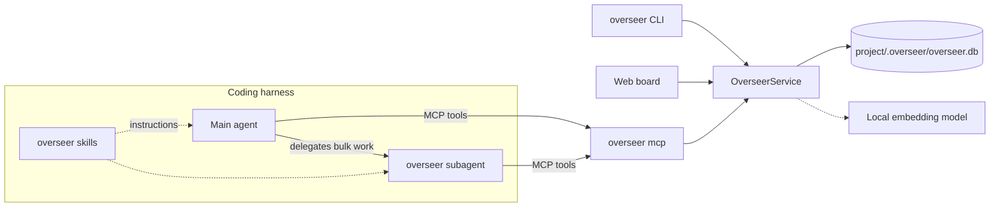

# overseer

A requirements registry and Agile board for coding agents. overseer stores each project's functional and non-functional requirements, epics, user stories, tasks and bugs in a local SQLite database with multilingual semantic search. It plugs into the coding harnesses you use (Claude Code, OMP, Codex CLI, Gemini CLI, GitHub Copilot CLI, Cursor, OpenCode) as a subagent, four skills and an MCP server. You can ask your agent "is password reset already covered?" or "record this requirement", or you can use the CLI and the local web board.

- **Off until you turn it on**: overseer works only in the projects where you run `overseer enable`. Everywhere else its tools and commands refuse and create nothing.
- **Local**: data stays in `<project>/.overseer/`. Embeddings run on your machine with `Xenova/multilingual-e5-small` (about 118 MB, downloaded once). overseer never calls an LLM; your harness's model does the reasoning.
- **Leaves your repository alone**: adding overseer to a project creates only `.overseer/`, and git ignores that folder because it holds its own `.gitignore`. Status and history reach the repository only when you export them.
- **Traceable**: stories and tasks `implement` requirements, and bugs `affect` them. Coverage (untracked → tracked → in progress → delivered → verified) is worked out from the linked work, so nobody has to keep it up to date by hand.
- **Catches duplicates**: every new item is compared with the existing ones, across languages too (an English request matches a Spanish requirement).



## Requirements

- Node.js ≥ 22.18 (uses the built-in `node:sqlite`). Developed and tested on Linux with Node 24.
- Semantic search needs a prebuilt `sqlite-vec` binary, available for Linux x64/arm64, macOS x64/arm64 and Windows x64. On other platforms, or while the model is not downloaded, overseer falls back to keyword search.
- About 120 MB of disk space and network access once, to download the embedding model.

## Install

The package is not published on npm yet. Install it from a checkout of this repository:

```sh
npm install
npm run build
npm link            # puts `overseer` on your PATH (or: npm install -g .)

overseer install    # choose your harnesses, wire them up, download the model
overseer doctor     # check runtime, model, project and harness setup

cd ~/work/my-app
overseer enable     # turn overseer on for this project (it is off everywhere by default)
```

In a terminal, `overseer install` shows what it found and lets you choose. Harnesses that are installed on your machine, or that already have overseer, start out checked:

```
Install overseer for which harnesses (user scope)?
  1. [x] claude   Claude Code         claude on PATH (/home/me/.local/bin/claude)
  2. [x] omp      OMP                 omp on PATH (/home/me/.local/bin/omp)
  3. [ ] codex    Codex CLI           ~/.codex exists, but codex is not on PATH
  4. [ ] gemini   Gemini CLI          not found
  5. [ ] copilot  GitHub Copilot CLI  not found
  6. [ ] cursor   Cursor              not found
  7. [ ] opencode OpenCode            not found
Numbers or names (comma-separated), "all", or Enter for [claude, omp]:
```

A harness counts as installed when its CLI is on `PATH`. A config folder alone does not count, because it may be left over from an uninstalled tool. The exception is Cursor: the desktop app often adds no shell command, so `~/.cursor` is enough.

- `--targets claude,omp` chooses without asking.
- Outside a terminal (scripts, CI), `install` uses the detected harnesses. If it finds none, it asks you to pass `--targets`.
- `--dry-run` prints every planned file write and command and changes nothing.
- `--skip-model` skips the model download; run `overseer models pull` later.

User-scope MCP registrations run your `node` binary and this checkout's `dist/cli.js` by absolute path. Harnesses launched from a desktop app often don't get your shell's `PATH`, so a plain `overseer` command might not be found; absolute paths avoid that. The catch: if you move the checkout or remove that Node version, run `overseer install` again. `overseer doctor` reports `FAIL` when those paths are gone.

## Where the files go

There are three kinds of files. The harness files say how a harness reaches overseer. The project data is your registry. The exports are what you share through the repository.

### Harness files, user scope (default)

`overseer install` writes into your home directory once, and it then works in every project. Nothing is written into your projects.

| Harness | Skills | Subagent | MCP server |
|---|---|---|---|
| Claude Code | `~/.claude/skills/` | `~/.claude/agents/overseer.md` | `claude mcp add --scope user overseer …` |
| OMP | `~/.omp/agent/skills/` | `~/.omp/agent/agents/overseer.md` | `~/.omp/agent/mcp.json` |
| Codex CLI | `~/.agents/skills/` | `~/.codex/agents/overseer.toml` | `~/.codex/config.toml` |
| Gemini CLI | `~/.agents/skills/` | `~/.gemini/agents/overseer.md` | `~/.gemini/settings.json` |
| GitHub Copilot CLI | `~/.agents/skills/` | `~/.copilot/agents/overseer.agent.md` | `~/.copilot/mcp-config.json` |
| Cursor | `~/.agents/skills/` | `~/.cursor/agents/overseer.md` | `~/.cursor/mcp.json` |
| OpenCode | `~/.config/opencode/skills/` | `~/.config/opencode/agents/overseer.md` | `~/.config/opencode/opencode.json` |

- **Skills**: four folders, `overseer`, `overseer-bootstrap`, `overseer-import` and `overseer-ship`.
- **Shared skills folder**: Codex, Gemini, Copilot and Cursor all read `~/.agents/skills/`, so overseer writes it once and removes it only when none of them still uses it.
- **Custom config folders**: the installer honours `CLAUDE_CONFIG_DIR`, `PI_CONFIG_DIR` / `PI_CODING_AGENT_DIR` (OMP), `CODEX_HOME`, `COPILOT_HOME` and `XDG_CONFIG_HOME`.
- **OMP named profiles** (`omp --profile work`) read `~/.omp/profiles/work/agent/` instead. Install there with `PI_CODING_AGENT_DIR=~/.omp/profiles/work/agent overseer install --targets omp`.

### Harness files, project scope (optional)

`overseer install --scope project` writes the same pieces into the repository. This is meant for teams: once you commit these files, everyone who clones the repo gets overseer in their harness.

| Harness | Skills | Subagent | MCP server |
|---|---|---|---|
| Claude Code | `.claude/skills/` | `.claude/agents/overseer.md` | `.mcp.json` |
| OMP | `.omp/skills/` | `.omp/agents/overseer.md` | `.omp/mcp.json` |
| Codex CLI | `.agents/skills/` | `.codex/agents/overseer.toml` | `.codex/config.toml` |
| Gemini CLI | `.agents/skills/` | `.gemini/agents/overseer.md` | `.gemini/settings.json` |
| GitHub Copilot CLI | `.agents/skills/` | `.github/agents/overseer.agent.md` | `.github/mcp.json` |
| Cursor | `.agents/skills/` | `.cursor/agents/overseer.md` | `.cursor/mcp.json` |
| OpenCode | `.agents/skills/` | `.opencode/agents/overseer.md` | `opencode.json` |

- **`overseer` must be on PATH**: in this scope the MCP command is plain `overseer mcp`, so every teammate needs `overseer` on their `PATH`.
- **Trust prompts**: harnesses ask before using project-level servers and agents. Claude Code asks each user to approve `.mcp.json` servers, Codex loads `.codex/config.toml` only for trusted projects, Gemini asks you to acknowledge project agents, and Copilot asks you to trust the folder.
- **Pick one scope per harness**: for personal use, the user scope is enough. If a harness has both, the two entries share the name `overseer`. In OMP the project entry takes precedence over the user one.
- **It turns the project on for you**, as `overseer enable` would. Each teammate's overseer stays off in their clone until they run `overseer enable` there once: a cloned repository can't turn itself on.

### How install edits files

- Every file overseer generates carries a `managed-by: overseer-cli` marker. An existing file without the marker is left alone with a warning, unless you pass `--force`.
- In shared config files (`mcp.json`, `settings.json`, `config.toml`, `opencode.json`), only the `overseer` entry is added or removed, and comments and formatting are kept. Before the first change, the original is copied to `<file>.overseer-backup`. An existing backup is never overwritten, and uninstall never creates or changes one.
- Running `install` again reports `unchanged` and writes nothing.

### Project data

| Path | Contents | Commit it? |
|---|---|---|
| `.overseer/overseer.db` (with `-wal`, `-shm` while open) | the registry: items, links, history, search indexes | no |
| `.overseer/.gitignore` | `*`, so git ignores the whole folder. Your own `.gitignore` is never touched | no |
| `docs/overseer/` (only after an export) | `README.md`, `requirements.md`, `backlog.md`, `history.md`, `overseer.json` | yes, that is what it is for |

- **When `.overseer/` appears**: on the first write in a project you turned on, from an agent recording an item, `overseer add`, `overseer init` or `overseer board`. Read-only commands never create it.
- **One registry per repository**: `.overseer/` lives at the root of the main checkout, so all git worktrees of a repository share one registry. Every harness uses the same database.
- **Deleting `.overseer/` deletes the registry.** The exports are a readable snapshot, not a backup you can restore from.

Two things are kept once per machine, outside any project:

| OS | Model cache | User config (on/off rules) |
|---|---|---|
| Linux | `~/.cache/overseer/models` (honours `XDG_CACHE_HOME`) | `~/.config/overseer/config.json` (honours `XDG_CONFIG_HOME`) |
| macOS | `~/Library/Caches/overseer/models` | `~/Library/Application Support/overseer/config.json` |
| Windows | `%LOCALAPPDATA%\overseer\models` | `%APPDATA%\overseer\config.json` |

Set `OVERSEER_MODEL_DIR` or `OVERSEER_CONFIG_DIR` to use different folders.

### How overseer finds the project

With a user-scope install, one MCP server serves every project. It works out the project on each call, using the first of these that is set:

1. the `project_dir` tool argument (CLI: `--project <dir>`)
2. `OVERSEER_PROJECT`
3. `CLAUDE_PROJECT_DIR` (set by Claude Code)
4. the first workspace root the harness advertises over MCP (`roots/list`)
5. the current directory

The result is then mapped to the root of the git repository's main checkout. Outside git, overseer uses the nearest parent folder that has a `.overseer/`. If that lands on your home directory or the filesystem root, overseer refuses to write (`NO_PROJECT`) rather than creating a registry there; the skills tell the agent to retry with `project_dir`.

## Turning overseer on and off

overseer is off everywhere by default, even after `overseer install`. Turn it on where you want it:

```sh
cd ~/work/my-app
overseer enable     # on for this project and every folder below it
overseer disable    # off again; the data is kept
```

- **Nothing is written into the project.** The folder goes into your user config (`enabled_projects` or `disabled_projects`; see the table above). `.overseer/` appears only when something is first recorded. `disable` keeps it; delete it yourself to remove the data.
- **Off means off at every entry point.** In a project that is off, every overseer MCP tool and every project command of the CLI (including `board`) answers `DISABLED` and creates nothing. The switch is read on every call, so running sessions follow it too. The MCP instructions, the skills and the subagent tell the agent to stop there, not to look for another way in, and not to run `overseer enable` itself unless you ask it to.
- **Folders cover what's below them, and the closest rule wins.** `overseer enable` in `~/work` turns on every project under it, and `overseer disable` in `~/work/client-x` then makes an exception. Running `overseer enable` in `~/work/client-x` again just removes the exception.
- **Other ways to turn a project on**: `overseer init` and `overseer install --scope project` do it too.
- **Existing registries**: a project that already has a `.overseer/` folder is off too, until you run `overseer enable` there; its data is then used as before.
- **What being off doesn't hide.** The harness still lists the skills and the subagent, and still starts the MCP server. To keep overseer's tool descriptions out of the model's context in a project, also turn the server off in the harness if it supports that per project. In Claude Code, toggle `overseer` off in `/mcp`; Claude Code saves that per project in `~/.claude.json`. OMP's `disabledServers` list applies to every project, not just one.
- **Checking the state.** `overseer doctor` shows whether overseer is off for the current project.

## Using it

### From your harness

In a project you turned on, talk to your agent as usual. The main agent calls the MCP tools directly for quick lookups and edits, and hands bulk work to the `overseer` subagent. Text is recorded in the language you use. In a project that is off, the agent tells you so when you ask for overseer, and does nothing else with it.

- "Record this requirement, asked by Ana: the public API must answer in under 300 ms at p95 with 100 requests per second."
- "Is password reset by email already covered?"
- "Add a bug: on Safari the login button does nothing. Expected the dashboard, got nothing. It affects REQ-0001."
- "Plan an epic for checkout with stories and tasks."
- "Use the overseer agent to bootstrap requirements from this codebase."
- "Import our GitHub issues into the board."
- "Ship TASK-0012: branch, implement and open the pull request."
- "US-0003 is done, delivered in PR #42. Anything drifting?"
- "Export the overseer reports."

### CLI

```sh
overseer enable                             # once per project
overseer add requirement --title "Password reset by email" --type functional --status approved \
  --description "When a user requests a password reset, the system shall email a single-use link that expires after 30 minutes." \
  --ac "Given a registered email, when a reset is requested, then a link valid for 30 minutes is sent"
overseer add story --title "Reset forgotten password" \
  --description "As a user I want to reset my password so that I can regain access" --implements REQ-0001
overseer update US-0001 --status done --delivered-in "PR #42"
overseer coverage "password reset"          # covered / partially / not_found
overseer similar "Restablecer la contraseña por correo"
overseer report drift
overseer export                             # writes docs/overseer/
```

| Command | Purpose |
|---|---|
| `enable` / `disable` | turn overseer on or off for this project and the folders below it (off by default) |
| `init [--name] [--asked-by]` | turn the project on and create `.overseer/` (optional: the first write creates it) |
| `add <kind> --title …` | record a requirement, epic, story, task or bug; refuses likely duplicates unless `--allow-duplicate` (`--json` prints a compact result, `--full` the whole item) |
| `update <id> …` | change fields or status, `--comment`, `--delivered-in`, `--clear <field>` (`--json` prints a compact result, `--full` the whole item) |
| `show <id>… [--context] [--history]` | items with links, children, coverage and history; several IDs (up to 50) print `{items:[…]}` with `--json`; `--context` adds the parent and the linked requirements with their acceptance criteria |
| `list [--kind] [--status] [--coverage] [--tag] [--all]` | list items (closed ones hidden unless `--all`) |
| `search <query>` | hybrid keyword + semantic search |
| `similar <text>` | duplicate check |
| `coverage <text>` | is this already covered, tracked or delivered? |
| `link` / `unlink <src> <rel> <dst>` | relate items |
| `report <kind>` | `summary`, `coverage`, `board`, `drift`, `lint`, `traceability` |
| `export [--out] [--only] [--since]` | write Markdown/JSON reports into the project |
| `import <file\|-> --source github\|gitlab --repo <repo>` | import issues from a JSON array |
| `pr draft <id> [--type <type>]` | pull request title and body for a task or bug (see below) |
| `worktree start <id> [--type] [--slug] [--base] [--no-setup]` | create or reuse the git worktree and branch of a task or bug (see [Worktrees](#worktrees)) |
| `worktree finish <id> --merged-head <sha> [--pr] [--base]` | after the merge: remove the worktree and branches, fast-forward the base, set the item done |
| `worktree list` | worktrees on task and bug branches, with their item IDs |
| `board [--port] [--no-open]` | serve the web board |
| `mcp` | run the MCP server over stdio (harnesses start it) |
| `models pull` | download the embedding model |
| `reindex` | rebuild the keyword index and re-embed every item |
| `config get [key] [--stored]` / `config set <key> <value>` | project settings (`--stored`: only the ones set in this project) |
| `install` / `uninstall` / `doctor` | harness wiring and health checks |

Every data command accepts `--json`. Errors go to stderr as `error: <CODE>: <message>` with exit code 1. With `--json`, they go to stdout as `{"error":{"code","message"}}`.

`add --json` and `create_item` return a compact result for agents: `{"created": true, "id", "title", "status", "verdict", "candidates": [{"id", "title", "similarity", "match"}], "warnings"}`. `verdict` and `candidates` come from the duplicate check and use `find_similar`'s values (`duplicate`, `related`, `new`, or `unknown` when only keyword search is available). A likely duplicate gives `{"created": false, "reason": "possible_duplicate", "verdict": "duplicate", "candidates"}` and nothing is written. `update --json` and `update_item` return `{"id", "title", "status", "changed_fields", "warnings"}`. `--full` (`full: true` in MCP) returns the whole item instead: `{"created", "item", "warnings", "similar"}`, `{"created": false, "reason", "candidates"}` and `{"item", "changed_fields", "warnings"}`. The text output and the web board are not affected.

`overseer pr draft TASK-0058 --json` prints `{"title", "body"}` for a pull request, ready for `gh pr create --title … --body …`:

- **Title**: `<type>: <summary> (<ID>)`, at most 100 characters. The type is `--type`, else the one in the current branch when it is named `<type>/<ID>-…`, else `fix` for bugs and `feat` for tasks. The summary is the item title in imperative form with a lowercase first letter (`Adds the sender` → `add the sender`).
- **Body**: the repository's `.github/pull_request_template.md`, else `.gitlab/merge_request_templates/Default.md`, else overseer's default template. Branch and template come from the checkout you run it in (linked worktrees included). The command fills the `Item:` line, the Why section (description plus linked requirements with their titles) and the acceptance criteria as a checklist, adding those sections when the template lacks them. For an imported GitHub or GitLab issue it adds `Closes owner/repo#N`. Other sections keep their HTML comment for you to complete.

The same item, template and branch always give the same draft. This command has no MCP tool.

### Worktrees

`overseer worktree start TASK-0038 --json` gives a task or bug its own branch and worktree and prints `{"path", "branch", "base", "reused", "setup": {"command", "ran"}}`:

- **Branch**: `branch_pattern` filled with the type (`--type`, else `fix` for bugs and `feat` for tasks; bugs always use `fix`), the ID and the slug (`--slug`, else the first four words of the title without accents and filler words: `Create and reuse issue worktrees` → `create-reuse-issue-worktrees`).
- **Path**: `<worktree_root>/<ID>-<slug>`, with `worktree_root` taken relative to the main checkout, also when you run the command inside another worktree.
- **New branch**: overseer fetches `origin` and starts from `origin/<base>`, else from the local `<base>`. The base is `--base`, else `base_branch`.
- **Reuse**: a worktree already on the branch is returned with `reused: true`. A branch without a worktree gets one, and no new branch is created. A path that exists but is not the branch's worktree gives `CONFLICT`, and nothing is changed.
- **Setup**: a new worktree runs `worktree_setup`, its output going to stderr. Without the setting, the command follows the lockfile: `npm ci`, `pnpm install --frozen-lockfile` or `yarn install --immutable`. `--no-setup` skips it. If the setup fails, the worktree is kept and the command exits with `SETUP_FAILED`, naming the command and the path.

`overseer worktree start` never changes the item's status.

`overseer worktree finish TASK-0038 --merged-head <sha> --pr <url> --json` cleans up after the pull request is merged. `<sha>` is the pull request's head commit (`gh pr view <url> --json headRefOid`). It prints `{"id", "status", "branch", "path", "remote_branch", "base": {"branch", "head", "fast_forwarded", "reason"}, "delivered_in", "code_refs"}`:

- **Branch**: the local or remote branch that fills `branch_pattern` with the ID (any type and slug). Its remote is the branch's upstream, else `origin`; overseer fetches it with `--prune` first. Two matching branches give `CONFLICT`.
- **Safety**: uncommitted or untracked changes in the worktree, or commits on the local or remote branch that the merged head lacks, give `CONFLICT` listing them, and nothing is removed. Ignored files (dependencies, build output) are removed with the worktree.
- **Cleanup**: deletes the remote branch when it is still there, removes the worktree and the local branch, and prunes the worktree list.
- **Base**: the local `--base` (else `base_branch`) is fast-forwarded to its remote, with `git merge --ff-only` where it is checked out. When it has local commits, or its checkout blocks the merge, it is left alone and `base.reason` says why.
- **Item**: set to `done`, with `delivered_in` = `--pr` (else the item's `delivered_in`; one of them is required) and `code_refs` = the files the branch changed against the base (else the item's `code_refs`).

`overseer worktree list --json` prints `[{"id", "branch", "path"}]` for every worktree on a branch that fills `branch_pattern`, the main checkout excluded. These commands have no MCP tool.

### Web board

`overseer board` (or asking the agent to open it) serves the board on `http://127.0.0.1:4477`. If that port is taken, it tries the next ones, up to 4496.

- **Board**: kanban for stories, tasks and bugs, with drag and drop between columns.
- **Requirements**: table with filters and semantic search.
- **Item pages**: editable fields, links, children, coverage and history, plus a comment box.
- **Coverage**: counts, drift and the traceability matrix.
- **New item** dialog with duplicate hints, and an **Export** button.

The page updates live when an agent or the CLI writes to the database. The server listens on 127.0.0.1 only and rejects requests whose `Host` is not localhost. Writes need a token generated each time the server starts.

### MCP tools

| Tool | Purpose |
|---|---|
| `find_similar` | items similar to a text; verdict `duplicate`, `related` or `new` |
| `check_coverage` | requirements covering a text, with their coverage and implementing items |
| `create_item` / `update_item` / `get_item` / `list_items` | item lifecycle; creates and updates return compact results unless `full: true` |
| `search` | hybrid search |
| `link_items` | add or remove a relation |
| `report` | the six reports, as Markdown plus data |
| `export_report` | write `docs/overseer/` |
| `import_items` | idempotent GitHub/GitLab issue import |
| `open_board` | start the web board and return its URL |

## Data model

| Kind | IDs | Statuses (the first is the default) |
|---|---|---|
| requirement | `REQ-0001` | `proposed`, `approved`, `implemented`, `verified`, `deferred`, `rejected`, `obsolete` |
| epic | `EPIC-0001` | `open`, `in_progress`, `done`, `cancelled` |
| story | `US-0001` | `backlog`, `ready`, `in_progress`, `review`, `done`, `cancelled` |
| task | `TASK-0001` | same as story |
| bug | `BUG-0001` | same as story |

Items are never deleted; you close them with a status. Lists hide `rejected`, `obsolete` and `cancelled` items unless you ask for `--all`.

Requirements carry:
- an EARS statement ("When <trigger>, the <system> shall <response>")
- a type: functional or non-functional
- for non-functional requirements, an ISO/IEC 25010 category and a measurable fit criterion
- a MoSCoW priority, a rationale and Given/When/Then acceptance criteria
- a verification method
- who asked for it, where it came from and which tool recorded it
- whether it is in the backlog
- tags, component, code references and delivery details

The full field reference is in [`templates/skills/overseer/references/fields.md`](templates/skills/overseer/references/fields.md).

| Relation | From → to |
|---|---|
| `implements` | story/task → requirement (also marks the requirement as in the backlog) |
| `affects` | bug → requirement/story |
| `refines`, `conflicts_with`, `supersedes` | requirement → requirement |
| `duplicates` | between items of the same kind |
| `depends_on`, `relates_to` | any → any |

Allowed parents: a story belongs to an epic, a task to a story, a bug to an epic or a story, and a requirement to another requirement (to break it down).

Requirement coverage is worked out from the linked work:

| Coverage | When |
|---|---|
| `untracked` | no implementing items and not in the backlog |
| `tracked` | in the backlog, or has implementing items |
| `in_progress` | an implementing item is `in_progress` or `review` |
| `delivered` | the requirement is `implemented`, or all its implementing items are `done` |
| `verified` | the requirement is `verified` |
| `not_applicable` | the requirement is `deferred`, `rejected` or `obsolete` |

- **`report drift`** flags status mismatches. It catches three cases: the work is done but the requirement is still open; the requirement is marked implemented while its work is unfinished; work has started on an unapproved requirement.
- **Lint warnings** (`report lint`, and the warnings returned when you create or update an item) cover:
  - vague terms in English and Spanish
  - several "shall" clauses in one requirement
  - non-functional requirements that can't be measured or lack a category
  - missing acceptance criteria
  - stories not written as "As a… I want… so that…"

  Warnings never block a write.

## Semantic search and duplicates

- Search combines FTS5 keyword matches with vector nearest neighbours and merges both rankings (reciprocal rank fusion).
- Each item gets three vectors: its full text (with acceptance criteria), its title, and its title plus description. An item's score is the highest of the three.
- Similarity and coverage checks subtract the mean vector of the project's items from both vectors before taking the cosine. Items of one product share a vocabulary: with plain cosine, every requirement of this repository scored between 0.85 and 0.96 against its nearest neighbour, so no threshold could tell duplicates apart. While a project has few items, the mean leans on a reference mean shipped for the model.
- A similarity of 0.61 or more counts as a duplicate, and 0.22 or more as related. `npm run calibrate` set these thresholds on two sets:
  - this repository's 242 requirements with 31 hand-written rewordings (`test/fixtures/registry-pairs.json`)
  - 71 English/Spanish requirement pairs (`test/fixtures/similarity-pairs.json`)

  At these thresholds, 5% of the requirements have a duplicate-class neighbour. 84% of the rewordings and 70% of the fixture duplicates count as duplicates, and every one of them at least as related.
- `add` and `create_item` return the candidates instead of creating the item when a duplicate is likely. When they do create it, they still return the `verdict` and the duplicate or related candidates.
- `search` reports plain cosine similarity, which only orders the results.
- Without the model or `sqlite-vec`, results are keyword-only and carry `semantic: false`.

## GitHub and GitLab issues

The `overseer-import` skill reads issues through the GitHub or GitLab MCP server configured in your harness, so overseer itself stores no tokens. It maps issues to items and calls `import_items` in batches.

- **Re-running is safe**: re-imports update titles, descriptions and labels. Status changes only when the remote open/closed state changes, and local data (priority, links, acceptance criteria, comments) stays.
- **One-way**: nothing is pushed back to GitHub or GitLab.
- **Setup**: commands for connecting each harness to GitHub or GitLab are in [`templates/skills/overseer-import/references/integrations.md`](templates/skills/overseer-import/references/integrations.md).

The CLI accepts the same payload:

```sh
echo '[{"external_id":"acme/demo#7","url":"https://github.com/acme/demo/issues/7","title":"Login fails on Safari","state":"open","labels":["bug"]}]' \
  | overseer import - --source github --repo acme/demo
```

## Configuration

`overseer config get` and `overseer config set <key> <value>` read and change per-project settings:

| Key | Default |
|---|---|
| `project_name` | the project folder's name |
| `default_asked_by` | `git config user.name`, else your OS user name |
| `export_dir` | `docs/overseer` |
| `board_port` | `4477` |
| `worktree_root` | `../<project folder name>.worktrees`, relative to the project root |
| `base_branch` | the remote's default branch (`refs/remotes/origin/HEAD`), else `main` |
| `branch_pattern` | `{type}/{id}-{slug}`; must contain `{id}` |
| `worktree_setup` | from the lockfile: `npm ci` (`package-lock.json`), `pnpm install --frozen-lockfile` (`pnpm-lock.yaml`), `yarn install --immutable` (`yarn.lock`), else `none`; `none` turns the setup off |

The last four are worked out when read until you set them, so `overseer config get <key> --json` always prints the value in effect. Add `--stored` to see only what was set in this project: `overseer config get --stored --json` leaves out the settings that still fall back to a default, and `overseer config get <key> --stored` fails with `NOT_FOUND` when that key was never set. The ship skill uses it to tell a first run from a later one.

Environment variables:

| Variable | Effect |
|---|---|
| `OVERSEER_PROJECT` | project directory when neither `--project` nor `project_dir` is given |
| `OVERSEER_ACTOR` | name recorded as the actor in the history |
| `OVERSEER_MODEL_DIR` | model cache folder |
| `OVERSEER_CONFIG_DIR` | user config folder (holds the on/off rules) |

## Uninstall

```sh
overseer uninstall                    # every harness overseer is installed for (user scope)
overseer uninstall --targets codex    # only one harness
overseer uninstall --scope project    # the project-scope files of the current project
npm rm -g overseer-cli                # remove the command itself
```

- **Removed**: the subagent files, skill folders and MCP entries overseer created, plus any folders that end up empty.
- **Kept**: `.overseer-backup` copies and any file without the managed marker.
- **Never touched**: a project's `.overseer/` folder. Delete it yourself to drop that project's registry. The model cache and your user config also stay (see [Project data](#project-data)).

## Development

```sh
npm install
npm run typecheck
npm test                  # vitest; a deterministic hash embedder, no model download
npm run build             # tsdown → dist/cli.js, vite → dist/web/
npm run dev:web           # SPA dev server; proxies /api to `overseer board` on 4477
OVERSEER_REAL_MODEL=1 npx vitest run test/real-model.test.ts   # duplicate detection with the real model
npm run calibrate         # suggested similarity thresholds; regenerates src/core/reference-means.ts
OVERSEER_UPDATE_GOLDEN=1 npx vitest run test/install.test.ts   # regenerate installer golden files
```

`npm ci` (its `prepare` script) points `core.hooksPath` at `.githooks/`. The hooks run `scripts/ensure-build.mjs` after `git pull`/`git merge` (including the fast-forward in `overseer worktree finish`), branch switches and rebases: it hashes the build inputs (files under `src/` and `web/`, `package.json`, `package-lock.json`, `tsconfig.json`, `tsdown.config.ts`, `vite.config.ts`), compares the hash with `dist/.build-hash` and runs `npm run build` when they differ, so the global `overseer` command runs the merged code. `npm run build` records the hash itself (`postbuild`). In a checkout without `node_modules` the hooks skip the build with a message. Run `node scripts/ensure-build.mjs` to check by hand.

| Path | Contents |
|---|---|
| `src/core/` | `OverseerService`, database and migrations, search and embeddings, coverage, lint, reports, export, import |
| `src/mcp/` | MCP server |
| `src/cli/` | CLI |
| `src/board/`, `web/` | board server and React app |
| `src/install/` | harness installer and doctor checks |
| `templates/` | skills and the subagent prompt that `install` copies |
| `test/` | test suites and fixtures |

## Status and limitations

- **Harness coverage**: tested end to end with Claude Code and OMP. The Codex, Gemini, Copilot, Cursor and OpenCode files follow those tools' documented formats and are covered by golden tests, but have not yet been run against the real CLIs.
- **OpenCode**: the installer picks the config format (1.x or 2.x) from `opencode --version`.
- **Imports are one-way**, and a database cannot be restored from `overseer.json`.
