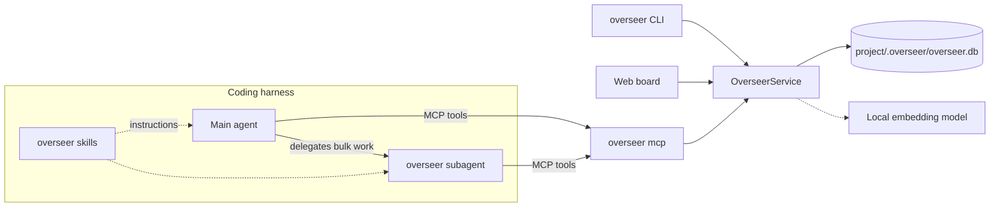

# overseer

A requirements registry and Agile board for coding agents. overseer stores each project's functional and non-functional requirements, epics, user stories, tasks and bugs in a local SQLite database with multilingual semantic search. It plugs into the coding harnesses you use (Claude Code, OMP, Codex CLI, Gemini CLI, GitHub Copilot CLI, Cursor, OpenCode) as a subagent, five skills and an MCP server. You can ask your agent "is password reset already covered?" or "record this requirement", or you can use the CLI and the local web board.

- **Off until you turn it on**: overseer works only in the projects where you run `overseer enable`. Everywhere else its tools and commands refuse and create nothing.
- **Local**: data stays in `<project>/.overseer/`. Embeddings run on your machine with `Xenova/multilingual-e5-small` (about 118 MB, downloaded once by `overseer install` or `overseer models pull`). overseer never calls an LLM; your harness's model does the reasoning.
- **Leaves your repository alone**: adding overseer to a project creates only `.overseer/`, and git ignores that folder because it holds its own `.gitignore`. Status and history reach the repository only when you export them.
- **Traceable**: stories and tasks `implement` requirements, and bugs `affect` them. Coverage (untracked → tracked → in progress → delivered → verified) is worked out from the linked work, so nobody has to keep it up to date by hand.
- **Catches duplicates**: every new item is compared with the existing items of the same kind, across languages too (an English request matches a Spanish requirement).



## Requirements

- Node.js ≥ 22.18 (uses the built-in `node:sqlite`). Developed and tested on Linux with Node 24.
- Semantic search needs a prebuilt `sqlite-vec` binary, available for Linux x64/arm64, macOS x64/arm64 and Windows x64. On other platforms, or while the model is not downloaded, overseer falls back to keyword search.
- About 120 MB of disk space and network access once, to download the embedding model. Only `overseer install` (without `--skip-model`) and `overseer models pull` download it; searches never do.

## Install

Install the package globally from npm:

```sh
npm install -g @kodrax/overseer

overseer install    # choose your harnesses, wire them up, download the model
overseer doctor     # check runtime, model, project and harness setup

cd ~/work/my-app
overseer enable     # turn overseer on for this project (it is off everywhere by default)
```

In a terminal, `overseer install` shows what it found and lets you choose. Harnesses that are installed on your machine, or that already have overseer, start out checked:

```
Install overseer for which harnesses (user scope)?
  1. [x] claude   Claude Code         claude on PATH (/home/me/.local/bin/claude)
  2. [x] omp      OMP                 omp on PATH (/home/me/.local/bin/omp)
  3. [ ] codex    Codex CLI           ~/.codex exists, but codex is not on PATH
  4. [ ] gemini   Gemini CLI          not found
  5. [ ] copilot  GitHub Copilot CLI  not found
  6. [ ] cursor   Cursor              not found
  7. [ ] opencode OpenCode            not found
Numbers or names (comma-separated), "all", or Enter for [claude, omp]:
```

A harness counts as installed when its CLI is on `PATH`. A config folder alone does not count, because it may be left over from an uninstalled tool. The exception is Cursor: the desktop app often adds no shell command, so `~/.cursor` is enough.

- `--targets claude,omp` chooses without asking.
- Without `--targets`, outside a terminal (scripts, CI) or with `--json`, `install` never prompts: it uses the detected harnesses plus those overseer is already installed for. If there are none, it asks you to pass `--targets`.
- `--dry-run` prints every planned file write and command and changes nothing.
- `--skip-model` skips the model download; run `overseer models pull` later.

User-scope MCP registrations run your `node` binary and the installed package's `dist/cli.js` by absolute path. Harnesses launched from a desktop app often don't get your shell's `PATH`, so a plain `overseer` command might not be found; absolute paths avoid that. The catch: if the package moves (for example a reinstall under another Node version) or that Node version is removed, run `overseer install` again. `overseer doctor` reports `FAIL` when those paths are gone.

## Where the files go

There are three kinds of files. The harness files say how a harness reaches overseer. The project data is your registry. The exports are what you share through the repository.

### Harness files, user scope (default)

`overseer install` writes into your home directory once, and it then works in every project. Nothing is written into your projects.

| Harness | Skills | Subagent | MCP server |
|---|---|---|---|
| Claude Code | `~/.claude/skills/` | `~/.claude/agents/overseer.md` | `claude mcp add --scope user overseer …` |
| OMP | `~/.omp/agent/skills/` | `~/.omp/agent/agents/overseer.md` | `~/.omp/agent/mcp.json` |
| Codex CLI | `~/.agents/skills/` | `~/.codex/agents/overseer.toml` | `~/.codex/config.toml` |
| Gemini CLI | `~/.agents/skills/` | `~/.gemini/agents/overseer.md` | `~/.gemini/settings.json` |
| GitHub Copilot CLI | `~/.agents/skills/` | `~/.copilot/agents/overseer.agent.md` | `~/.copilot/mcp-config.json` |
| Cursor | `~/.agents/skills/` | `~/.cursor/agents/overseer.md` | `~/.cursor/mcp.json` |
| OpenCode | `~/.config/opencode/skills/` | `~/.config/opencode/agents/overseer.md` | `~/.config/opencode/opencode.json` |

- **Skills**: five folders, `overseer`, `overseer-bootstrap`, `overseer-import`, `overseer-ship` and `overseer-sync`.
- **Shared skills folder**: Codex, Gemini, Copilot and Cursor all read `~/.agents/skills/`, so overseer writes it once and removes it only when none of them still uses it.
- **Custom config folders**: the installer honours `CLAUDE_CONFIG_DIR`, `PI_CONFIG_DIR` / `PI_CODING_AGENT_DIR` (OMP), `CODEX_HOME`, `COPILOT_HOME` and `XDG_CONFIG_HOME`.
- **OMP named profiles** (`omp --profile work`) read `~/.omp/profiles/work/agent/` instead. Install there with `PI_CODING_AGENT_DIR=~/.omp/profiles/work/agent overseer install --targets omp`.

### Harness files, project scope (optional)

`overseer install --scope project` writes the same pieces into the repository. This is meant for teams: once you commit these files, everyone who clones the repo gets overseer in their harness.

| Harness | Skills | Subagent | MCP server |
|---|---|---|---|
| Claude Code | `.claude/skills/` | `.claude/agents/overseer.md` | `.mcp.json` |
| OMP | `.omp/skills/` | `.omp/agents/overseer.md` | `.omp/mcp.json` |
| Codex CLI | `.agents/skills/` | `.codex/agents/overseer.toml` | `.codex/config.toml` |
| Gemini CLI | `.agents/skills/` | `.gemini/agents/overseer.md` | `.gemini/settings.json` |
| GitHub Copilot CLI | `.agents/skills/` | `.github/agents/overseer.agent.md` | `.github/mcp.json` |
| Cursor | `.agents/skills/` | `.cursor/agents/overseer.md` | `.cursor/mcp.json` |
| OpenCode | `.agents/skills/` | `.opencode/agents/overseer.md` | `opencode.json` |

- **`overseer` must be on PATH**: in this scope the MCP command is plain `overseer mcp`, so every teammate needs `overseer` on their `PATH`.
- **Trust prompts**: harnesses ask before using project-level servers and agents. Claude Code asks each user to approve `.mcp.json` servers, Codex loads `.codex/config.toml` only for trusted projects, Gemini asks you to acknowledge project agents, and Copilot asks you to trust the folder.
- **Pick one scope per harness**: for personal use, the user scope is enough. If a harness has both, the two entries share the name `overseer`. In OMP the project entry takes precedence over the user one.
- **It turns the project on for you**, as `overseer enable` would. Each teammate's overseer stays off in their clone until they run `overseer enable` there once: a cloned repository can't turn itself on.

### How install edits files

- Every file overseer generates carries a `managed-by: overseer-cli` marker. An existing file without the marker, or a skill folder whose `SKILL.md` lacks it, is left alone with a warning, unless you pass `--force`.
- With `--force`, each existing file overseer replaces is first copied to `<file>.overseer-backup` next to it. In a skill folder, that means `SKILL.md.overseer-backup` and so on for each replaced file, never a copied folder, so the harness doesn't load a second skill. Files overseer doesn't ship stay as they are. An existing backup is never overwritten, and the warning says which backups hold what.
- In shared config files (`mcp.json`, `settings.json`, `config.toml`, `opencode.json`), only the `overseer` entry is added or removed, and comments and formatting are kept. Before the first change, the original is copied to `<file>.overseer-backup`. An existing backup is never overwritten, and uninstall never creates or changes one.
- Running `install` again reports `unchanged` and writes nothing.

### Project data

| Path | Contents | Commit it? |
|---|---|---|
| `.overseer/overseer.db` (with `-wal`, `-shm` while open) | the registry: items, links, history, search indexes | no |
| `.overseer/.gitignore` | `*`, so git ignores the whole folder. Your own `.gitignore` is never touched | no |
| `docs/overseer/` (only after an export) | `README.md`, `requirements.md`, `backlog.md`, `history.md`, `overseer.json` | yes, that is what it is for |

- **When `.overseer/` appears**: on the first write in a project you turned on, from an agent recording an item, `overseer add`, `overseer init` or `overseer board`. Read-only commands never create it.
- **One registry per repository**: `.overseer/` lives at the root of the main checkout, so all git worktrees of a repository share one registry. Every harness uses the same database.
- **Deleting `.overseer/` deletes the registry.** The exports are a readable snapshot, not a backup you can restore from.

Two things are kept once per machine, outside any project:

| OS | Model cache | User config (on/off rules) |
|---|---|---|
| Linux | `~/.cache/overseer/models` (honours `XDG_CACHE_HOME`) | `~/.config/overseer/config.json` (honours `XDG_CONFIG_HOME`) |
| macOS | `~/Library/Caches/overseer/models` | `~/Library/Application Support/overseer/config.json` |
| Windows | `%LOCALAPPDATA%\overseer\models` | `%APPDATA%\overseer\config.json` |

Set `OVERSEER_MODEL_DIR` or `OVERSEER_CONFIG_DIR` to use different folders.

### How overseer finds the project

With a user-scope install, one MCP server serves every project. It works out the project on each call, using the first of these that is set:

1. the `project_dir` tool argument (CLI: `--project <dir>`)
2. `OVERSEER_PROJECT`
3. `CLAUDE_PROJECT_DIR` (set by Claude Code)
4. the first workspace root the harness advertises over MCP (`roots/list`)
5. the current directory

The result is then mapped to the root of the git repository's main checkout. Outside git, overseer uses the nearest parent folder that has a `.overseer/`. If that lands on your home directory, one of its ancestors (such as `/home`) or the filesystem root, overseer refuses to write (`NO_PROJECT`) rather than creating a registry there; the skills tell the agent to retry with `project_dir`.

## Turning overseer on and off

overseer is off everywhere by default, even after `overseer install`. Turn it on where you want it:

```sh
cd ~/work/my-app
overseer enable     # on for this project and every folder below it
overseer disable    # off again; the data is kept
```

- **Nothing is written into the project.** The folder goes into your user config (`enabled_projects` or `disabled_projects`; see the table above). `.overseer/` appears only when something is first recorded. `disable` keeps it; delete it yourself to remove the data.
- **Off means off at every entry point.** In a project that is off, every overseer MCP tool and every project command of the CLI (including `board`) answers `DISABLED` and creates nothing. The switch is read on every call, so running sessions follow it too. The MCP instructions, the skills and the subagent tell the agent to stop there, not to look for another way in, and not to run `overseer enable` itself unless you ask it to.
- **Folders cover what's below them, and the closest rule wins.** `overseer enable` in `~/work` turns on every project under it, and `overseer disable` in `~/work/client-x` then makes an exception. Running `overseer enable` in `~/work/client-x` again just removes the exception.
- **Other ways to turn a project on**: `overseer init` and `overseer install --scope project` do it too.
- **Existing registries**: a project that already has a `.overseer/` folder is off too, until you run `overseer enable` there; its data is then used as before.
- **What being off doesn't hide.** The harness still lists the skills and the subagent, and still starts the MCP server. To keep overseer's tool descriptions out of the model's context in a project, also turn the server off in the harness if it supports that per project. In Claude Code, toggle `overseer` off in `/mcp`; Claude Code saves that per project in `~/.claude.json`. OMP's `disabledServers` list applies to every project, not just one.
- **Checking the state.** `overseer doctor` shows whether overseer is off for the current project.

## Using it

### From your harness

In a project you turned on, talk to your agent as usual. The main agent calls the MCP tools directly for quick lookups and edits, and hands bulk work to the `overseer` subagent. Text is recorded in the language you use. In a project that is off, the agent tells you so when you ask for overseer, and does nothing else with it.

- "Record this requirement, asked by Ana: the public API must answer in under 300 ms at p95 with 100 requests per second."
- "Is password reset by email already covered?"
- "Add a bug: on Safari the login button does nothing. Expected the dashboard, got nothing. It affects REQ-0001."
- "Plan an epic for checkout with stories and tasks."
- "Connect this project to our GitHub repository."
- "Use the overseer agent to bootstrap requirements from this codebase."
- "Import our GitHub issues into the board."
- "Ship TASK-0012: branch, implement and open the pull request."
- "US-0003 is done, delivered in PR #42. Anything drifting?"
- "Export the overseer reports."

### CLI

```sh
overseer enable                             # once per project
overseer add requirement --title "Password reset by email" --type functional --status approved \
  --description "When a user requests a password reset, the system shall email a single-use link that expires after 30 minutes." \
  --ac "Given a registered email, when a reset is requested, then a link valid for 30 minutes is sent"
overseer add story --title "Reset forgotten password" \
  --description "As a user I want to reset my password so that I can regain access" --implements REQ-0001
overseer add --batch dictation.json         # up to 50 items in one call (see below)
overseer update US-0001 --status done --delivered-in "PR #42"
overseer coverage "password reset"          # covered / partially / not_found
overseer similar "Restablecer la contraseña por correo"
overseer report drift
overseer export                             # writes docs/overseer/
```

| Command | Purpose |
|---|---|
| `enable` / `disable` | turn overseer on or off for this project and the folders below it (off by default) |
| `init [--name] [--asked-by]` | turn the project on and create `.overseer/` (optional: the first write creates it) |
| `add <kind> --title …` | record a requirement, epic, story, task or bug; refuses likely duplicates unless `--allow-duplicate` (`--json` prints a compact result, `--full` the whole item) |
| `add --batch <file\|->` | record up to 50 items from a JSON array in one transaction, all or nothing (see [Batch create](#batch-create)) |
| `update <id> …` | change fields or status, `--comment`, `--delivered-in`, `--clear <field>` (`--json` prints a compact result, `--full` the whole item) |
| `show <id>… [--context] [--history]` | items with links, children, coverage and history; several IDs (up to 50) print `{items:[…]}` with `--json`; `--context` adds the parent and the linked requirements with their acceptance criteria; an ID may be an issue reference such as `acme/demo#7` or an issue URL (see [Issue references](#issue-references)) |
| `list [--kind] [--status] [--type] [--coverage] [--tag] [--parent] [--all] [--limit] [--offset]` | list items (closed ones hidden unless `--all`); `--type` filters requirements by `functional` or `non_functional`, `--parent <id>` lists an item's children; pages of `--limit` items (default 50) starting at `--offset` |
| `search <query>` | hybrid keyword + semantic search |
| `similar <text>` | duplicate check |
| `coverage <text>` | is this already covered, tracked or delivered? |
| `link` / `unlink <src> <rel> <dst>` | relate items |
| `delete <id>` | delete an item without children, with its links; a tombstone keeps its ID, kind, title, external refs, time and actor (see [Data model](#data-model)) |
| `report <kind>` | `summary`, `coverage`, `board`, `drift`, `lint`, `traceability` |
| `export [--out] [--only] [--since]` | write Markdown/JSON reports into the project |
| `import <file\|-> --source github\|gitlab --repo <repo>` | import issues from a JSON array of ImportItems or a raw GitHub/GitLab MCP response, optionally with `deleted` issues |
| `pr draft <id> [--type <type>]` | pull request title and body for a task or bug (see below) |
| `pr opened [<id>] --url <url>` | record an opened pull request: the item becomes review with `delivered_in` and `code_refs` (see below) |
| `worktree start <id> [--type] [--slug] [--base] [--no-setup]` | create or reuse the git worktree and branch of a task or bug and set a backlog or ready item in_progress (see [Worktrees](#worktrees)) |
| `worktree finish <id> --merged-head <sha> [--pr] [--base]` | after the merge: remove the worktree and branches, fast-forward the base, set the item done and roll its story up to done |
| `worktree list` | worktrees on task and bug branches, with their item IDs |
| `sync remotes` | GitHub, GitLab and other repositories named by the project's git remotes (see [Repository remotes](#repository-remotes)) |
| `sync status` | sync state: each connection with its MCP server, auto-sync flag, last sync cursor, sync start time and pending outbox entries, and the source of truth (see [Sync status](#sync-status)) |
| `sync connections` | the project's repository connections, with their MCP server and auto-sync flag (see [Repository connections](#repository-connections)) |
| `sync connection add --host github\|gitlab --repo <repo> [--mcp-server <name>]` | connect a GitHub or GitLab repository to the project, with auto-sync on |
| `sync connection set <id> [--auto-sync on\|off] [--mcp-server <name>]` | change a connection's auto-sync flag or MCP server |
| `sync connection remove <id>` | delete a connection with its remote refs, mappings and pending outbox rows; a removed source of truth goes back to the board |
| `sync source-of-truth` | the source of truth and why: `board` until sync starts on a connection, then that connection with its host and repository (see [Source of truth](#source-of-truth)) |
| `sync inspect <file\|-> --source github\|gitlab` | labels, issue types, milestones, sub-issue support and boards of a repository, from a bundle of raw MCP responses (see [Tracking setup](#tracking-setup)) |
| `sync mapping <connection>` | a connection's kind, status and priority mapping, every local value listed and unmapped ones marked (see [Kind, status and priority mapping](#kind-status-and-priority-mapping)) |
| `sync mapping set <connection> --dimension kind\|status\|priority --local <value> --remote <value>` | map one local value to a label, issue type or state, replacing its earlier remote value |
| `sync mapping import <connection> <file\|->` | replace a connection's whole mapping with a JSON mapping, all or nothing |
| `sync outbox [<connection>]` | local item changes waiting to be pushed, per connection with auto-sync on (see [Outbox](#outbox)) |
| `sync outbox ack <seq...>` | remove outbox entries once their push is confirmed, all or nothing |
| `sync start <connection> <file\|->` | start syncing a connection, once: an empty repository is seeded from the board (a create queued for every item without an issue there), a repository with issues comes to the board as an import (nothing queued); records its sync start time (see [Sync start](#sync-start)) |
| `sync plan <connection> <file\|->` | the push and pull operations that would sync a connection, with conflicts resolved by the source of truth, from a raw MCP listing of its issues; writes nothing (see [Sync plan](#sync-plan)) |
| `sync pull <connection> <file\|->` | apply the pull operations of `sync plan`: create items for new issues and apply remote changes without a pending local change, or that win as source of truth (see [Sync pull](#sync-pull)) |
| `sync confirm <connection> <file\|->` | record the pushes run for a plan: remote ref, snapshot of the pushed values, outbox ack; all or nothing (see [Sync confirm](#sync-confirm)) |
| `board [--port] [--no-open]` | serve the web board |
| `mcp` | run the MCP server over stdio (harnesses start it) |
| `models pull` | download the embedding model |
| `reindex` | rebuild the keyword index and re-embed every item |
| `config get [key] [--stored]` / `config set <key> <value>` | project settings (`--stored`: only the ones set in this project) |
| `install` / `uninstall` / `doctor` | harness wiring and health checks |

Every command except `mcp`, `board` and `models pull` accepts `--json`. Errors go to stderr as `error: <CODE>: <message>` with exit code 1. With `--json`, they go to stdout as `{"error":{"code","message"}}`, plus `"details"` when the error carries them (a missing issue to import, the problems of a batch). MCP tools answer `<CODE>: <message>` with `isError: true`; details come as a second text block `{"details": …}` and as `structuredContent.error.details`.

`add --json` and `create_item` return a compact result for agents: `{"created": true, "id", "title", "status", "verdict", "candidates": [{"id", "title", "similarity", "match"}], "warnings"}`. `verdict` and `candidates` come from the duplicate check and use `find_similar`'s values (`duplicate`, `related`, `new`, or `unknown` when only keyword search is available). A likely duplicate gives `{"created": false, "reason": "possible_duplicate", "verdict": "duplicate", "candidates"}` and nothing is written. `update --json` and `update_item` return `{"id", "title", "status", "changed_fields", "warnings"}`. `--full` (`full: true` in MCP) returns the whole item instead: `{"created", "item", "warnings", "similar"}`, `{"created": false, "reason", "candidates"}` and `{"item", "changed_fields", "warnings"}`. The text output and the web board are not affected.

`overseer pr draft TASK-0058 --json` prints `{"title", "body"}` for a pull request, ready for `gh pr create --title … --body …`:

- **Title**: `<type>: <summary> (<ID>)`, at most 100 characters. The type is `--type`, else the one in the current branch when it is named `<type>/<ID>-…`, else `fix` for bugs and `feat` for tasks. The summary is the item title in imperative form with a lowercase first letter (`Adds the sender` → `add the sender`).
- **Body**: the repository's `.github/pull_request_template.md`, else `.gitlab/merge_request_templates/Default.md`, else overseer's default template. Branch and template come from the checkout you run it in (linked worktrees included). The command fills the `Item:` line, the Why section (description plus linked requirements with their titles) and the acceptance criteria as a checklist, adding those sections when the template lacks them. Under `Item:` it closes the item's issue in each repository it is linked to (the imported issue and the issues of its sync connections): `Closes owner/repo#N` for every issue on the pull request's host, which is that of the branch's upstream remote, else `origin` (a self-hosted server takes the host of the connections to its repository). An issue on the other host, which the pull request cannot close, gets `Also tracked in GitLab: <issue URL>` (or `GitHub`) instead. Without a known host every issue gets `Closes`. Other sections keep their HTML comment for you to complete.

The same item, template, branch and remote always give the same draft. This command has no MCP tool.

`overseer pr opened --url <url> --json`, run inside an item's worktree after the pull request is created, prints `{"id", "status", "branch", "base", "delivered_in", "code_refs"}`:

- **Item**: read from the current branch with `branch_pattern`. A branch the pattern does not produce for a task or bug ID (or a detached HEAD) gives `INVALID_INPUT` naming the branch and the pattern. With an explicit ID (`overseer pr opened TASK-0058 --url <url>`) it works from any folder, using the local, else `origin`, branch that fills `branch_pattern` with the ID.
- **Status**: the item becomes `review` with `delivered_in` = the URL, `code_refs` = the files the branch changed since its merge-base with `origin/<base_branch>` (else the local base branch; the item's `code_refs` when nothing changed) and a comment with the URL. This command has no MCP tool.

### Batch create

`overseer add --batch <file|->` and `create_item` with `items` record up to 50 items in one call. The file is a JSON array (or `{"items": [...]}`); `create_item` takes `items` instead of the single-item fields, never both. Each entry takes the `create_item` fields plus an optional `key`: 1–64 letters, digits, `_`, `.` or `-`. `parent_id` and `links[].to` take an existing ID or `@<key>` of another entry in the same batch, in any order. Item IDs never start with `@`, so a reference is a batch key exactly when it does.

```json
[
  {"key": "r1", "kind": "requirement", "req_type": "functional", "title": "Redeem a gift card at checkout"},
  {"key": "s1", "kind": "story", "title": "Pay with a gift card", "parent_id": "EPIC-0002", "links": [{"rel": "implements", "to": "@r1"}]},
  {"kind": "task", "title": "Add the gift card field to checkout", "parent_id": "@s1"}
]
```

- **Validated as a whole first**: entry schemas and unknown fields, kind rules, statuses, duplicate keys, unknown keys and IDs, parent and link kind rules, and parent cycles. Any problem writes nothing; the `INVALID_INPUT` message lists every one as `items[<index>] (@<key>): …`.
- **Duplicate check per entry**: each entry is compared with the stored items and with the earlier entries of the same kind, as a single create does. If any entry is a likely duplicate and lacks its own `"allow_duplicate": true`, nothing is written and the result is `{"created": false, "reason": "possible_duplicate", "duplicates": [{"index", "key", "candidates"}]}`. A candidate from the batch carries `index` and `key` instead of an `id`.
- **One transaction**: IDs follow the batch order. On success, `--json` and `create_item` return `{"created": true, "items": [{"key", "id", "title", "status", "verdict", "candidates", "warnings"}]}`; `--full` (`full: true`) returns `{"created": true, "items": [{"key", "item", "warnings", "similar"}]}`.

### Worktrees

`overseer worktree start TASK-0038 --json` gives a task or bug its own branch and worktree and prints `{"path", "branch", "base", "reused", "status", "setup": {"command", "ran"}}`:

- **Branch**: `branch_pattern` filled with the type (`--type`, else `fix` for bugs and `feat` for tasks; bugs always use `fix`), the ID and the slug (`--slug`, else the first four words of the title without accents and filler words: `Create and reuse issue worktrees` → `create-reuse-issue-worktrees`).
- **Path**: `<worktree_root>/<ID>-<slug>`, with `worktree_root` taken relative to the main checkout, also when you run the command inside another worktree.
- **New branch**: overseer fetches `origin` and starts from `origin/<base>`, else from the local `<base>`. The base is `--base`, else `base_branch`.
- **Dependencies**: without `--base`, an item that `depends_on` a task or bug that is not `done` or `cancelled` gives `CONFLICT` and nothing is created. The message lists each one with its status and its branch (local or on `origin`) when it has one. Wait for it, or stack on it with `--base <its branch>` so the pull request targets that branch; any explicit `--base`, including the base branch, starts anyway. Requirements and other non-work targets are ignored, and a reused worktree is never blocked.
- **Reuse**: a worktree already on the branch is returned with `reused: true`. A branch without a worktree gets one, and no new branch is created. A path that exists but is not the branch's worktree gives `CONFLICT`, and nothing is changed.
- **Setup**: a new worktree runs `worktree_setup`, its output going to stderr. Without the setting, the command follows the lockfile: `npm ci`, `pnpm install --frozen-lockfile` or `yarn install --immutable`. `--no-setup` skips it. If the setup fails, the worktree is kept and the command exits with `SETUP_FAILED`, naming the command and the path.
- **Status**: once the worktree is created or reused, an item in `backlog` or `ready` becomes `in_progress` with a comment naming the branch; `status` is the item's status afterwards. Items already `in_progress`, `review` or later are left alone.

`overseer worktree finish TASK-0038 --merged-head <sha> --pr <url> --json` cleans up after the pull request is merged. `<sha>` is the pull request's head commit (`gh pr view <url> --json headRefOid`). It prints `{"id", "status", "branch", "path", "remote_branch", "base": {"branch", "head", "fast_forwarded", "reason"}, "delivered_in", "code_refs", "story_done"}`:

- **Branch**: the local or remote branch that fills `branch_pattern` with the ID (any type and slug). Its remote is the branch's upstream, else `origin`; overseer fetches it with `--prune` first. Two matching branches give `CONFLICT`.
- **Safety**: uncommitted or untracked changes in the worktree, or commits on the local or remote branch that the merged head lacks, give `CONFLICT` listing them, and nothing is removed. Ignored files (dependencies, build output) are removed with the worktree.
- **Cleanup**: deletes the remote branch when it is still there, removes the worktree and the local branch, and prunes the worktree list.
- **Base**: the local `--base` (else `base_branch`) is fast-forwarded to its remote, with `git merge --ff-only` where it is checked out. When it has local commits, or its checkout blocks the merge, it is left alone and `base.reason` says why.
- **Item**: set to `done`, with `delivered_in` = `--pr` (else the item's `delivered_in`; one of them is required) and `code_refs` = the files the branch changed against the base (else the item's `code_refs`).
- **Story**: when the item's parent is a story and every task and bug under it is now `done` or `cancelled`, with at least one `done`, the story becomes `done` with a comment and `story_done` is its ID (else `null`). Epics are never changed.

`overseer worktree list --json` prints `[{"id", "branch", "path"}]` for every worktree on a branch that fills `branch_pattern`, the main checkout excluded. These commands have no MCP tool.

### Connect

The `overseer-sync` skill connects the project to its GitHub or GitLab repositories, through the GitHub or GitLab MCP server configured in your harness. Ask your agent "connect this project to GitHub" and it:

1. Lists the repositories of the project's git remotes (`sync remotes`), asks which host an `unknown` one is, and offers them.
2. Checks that the session has the host's MCP tools; if not, it shows your harness's setup from [`overseer-import/references/integrations.md`](templates/skills/overseer-import/references/integrations.md) and stops. Otherwise it asks which MCP server reaches the repository, offering the servers it finds in the session (by their tool-name prefix) or the host default, `github` or `gitlab`.
3. Connects only the repositories you confirm, storing that server (`sync connection add --mcp-server <name>`, auto-sync on; `sync connection set <id> --mcp-server <name>` for a repository already connected).
4. Fetches the repository's labels, issue types, milestones and boards through the MCP server, summarises them with `sync inspect`, proposes a kind, status and priority mapping from those existing names, and stores it with `sync mapping import` once you confirm. Values without a matching name stay unmapped and are listed; no label is created.
5. Starts sync on each connection, after its mapping so seeded issues get its labels: it fetches every page of the repository's issue listing through the MCP server and runs [`sync start`](#sync-start), then tells you which case applied. An empty repository (`from: "board"`) is seeded from the board: it reports the creates queued by kind and goes straight on to the [sync](#sync-plan) (plan, pushes through the MCP server, `sync confirm`), so every item becomes an issue (closed items' issues closed). A repository with issues (`from: "repository"`) brings them to the board: it reports the items created and linked, and the items already on the board are not pushed. A connection whose sync already started (`CONFLICT`) goes straight to the sync.
6. Tells you the [source of truth](#source-of-truth) is the board until sync starts on a connection, then that connection; it never asks you to choose one.
7. Ends with `sync status`.

Every GitHub or GitLab call of the skill, when connecting and when syncing, goes to the tools of the connection's stored MCP server (`mcp_server` in `sync connections --json`), named with your harness's prefix (for example `mcp__<server>__<tool>` in Claude Code and Codex, `mcp__<server>_<tool>` in OMP); a connection without one uses the host default, `github` or `gitlab`.

### Repository remotes

`overseer sync remotes --json` lists the repositories the project's git remotes point to, as candidates for connecting the project to GitHub or GitLab. It prints `[{"host", "hostname", "repository", "remotes": [{"name", "url"}]}]`; without `--json`, a table:

- **Remotes**: every remote, not only `origin`, with its fetch and push URLs as `git remote -v` shows them. SSH (`git@host:path`), `ssh://host:port/path`, `git://` and `http(s)://` URLs are read, with or without `.git` and a trailing slash. Local paths and `file://` URLs are skipped.
- **Repository**: `hostname` is lowercase without user or port; `repository` is the path without `.git` and slashes around it (`acme/demo`, `group/sub/project`).
- **Host**: `github` for `github.com`, `gitlab` for `gitlab.com` and any hostname containing `gitlab` (`gitlab.example.com`), else `unknown` (GitHub Enterprise, `git.example.com`) with the path kept, so the user says what it is.
- **One entry per repository**: remotes pointing to the same hostname and path (case-insensitive) share an entry listing all of them.
- **Credentials**: user and password are removed from `http(s)` URLs, so tokens are never printed.
- **No remotes**, or a folder outside git, print `[]` (`No git remotes.` without `--json`).

It reads only the local git config and makes no network calls. This command has no MCP tool.

### Repository connections

A connection is one GitHub or GitLab repository the project syncs with. `overseer sync connection add --host github --repo acme/demo --mcp-server github --json` stores it and prints `{"id", "host", "repository", "mcp_server", "auto_sync", "last_sync_cursor", "sync_started_at", "created_at"}`; without `--json`, one `key: value` line per field:

- **Repository**: `owner/repo` on GitHub; `group/project` on GitLab, with any number of subgroups (`group/sub/project`). Slashes around it and `.git` are dropped, as in `sync remotes`. Each part holds letters, digits, `.`, `_` and `-`. Another host, or another repository shape (a URL, `acme`, `acme/demo/extra` on GitHub), gives `INVALID_INPUT`.
- **One connection per repository**: the same host and repository again (case-insensitive) gives `CONFLICT` naming the existing connection's id.
- **MCP server**: the harness MCP server that reaches the repository (`--mcp-server`), else `null`.
- **Auto-sync**: on for a new connection; `last_sync_cursor` is `null` until the first pull, and `sync_started_at` until [`sync start`](#sync-start).

`overseer sync connections --json` lists every connection by id (`[]` when there is none; `No connections.` and a table without `--json`). `overseer sync connection set <id> --auto-sync on|off --mcp-server <name> --json` changes either field and prints the connection; give at least one. `overseer sync connection remove <id> --json` deletes the connection together with its issue references on items, its kind/status/priority mappings and its pending outbox rows, and prints `{"removed": <connection>, "remote_refs", "mappings", "outbox", "source_of_truth_reset"}` with the number of rows deleted from each. When the removed connection was the source of truth, the board becomes the source of truth in the same step, even when another connection has started sync: `source_of_truth_reset` is `true` and the text output adds `Source of truth reset to board.`. An unknown id gives `NOT_FOUND`.

These commands read and write only the project database: they make no GitHub or GitLab call and record nothing in item history. They have no MCP tool.

`overseer doctor` adds one `connection <id>` line per connection, after the harness checks. It looks for the connection's MCP server in each harness overseer is installed for, in user scope and in the current project's scope: in the config file overseer registers its own server in (Codex's `config.toml`, the JSON or JSONC file of the other harnesses), and for Claude Code in user scope through `claude mcp get <name>`, or `claude mcp list` when the connection names no server.

- **By name**: a connection with an MCP server counts a server with that name.
- **By host**: a connection without one counts a server whose URL or command contains the host's usual server: `api.githubcopilot.com/mcp` or `github-mcp-server` for GitHub, `@zereight/mcp-gitlab` or `/api/v4/mcp` for GitLab.
- **OK** names the server, with its URL or command, and the harnesses that have it, then the harnesses that don't: `OK    connection 1: github acme/demo: MCP server "github" (https://api.githubcopilot.com/mcp/) in omp (user); not in claude (user)`.
- **WARN** when no harness has it, naming the connection, the harnesses checked and the setup guide (`overseer-import/references/integrations.md` in the installed skills of a checked harness, else in this package's `templates/skills`): `WARN  connection 2: gitlab group/app: no GitLab MCP server (@zereight/mcp-gitlab or /api/v4/mcp) in claude (user), omp (user); set one up as /home/me/.claude/skills/overseer-import/references/integrations.md shows`. A harness config that cannot be read, or `claude` missing from `PATH`, is listed as `cannot check <harness>: <reason>`.

A project without connections gets no `connection` lines, and doctor reads no harness MCP config and runs no harness command for them. doctor itself makes no network call; Claude Code's CLI may check its servers' health when it lists them.

### Source of truth

The source of truth is where synced item fields come from when the board and a connected repository disagree: the board, or one connection. Nobody chooses it; it follows from [`sync start`](#sync-start):

- **Board** until sync starts on a connection.
- **Connection**: the first connection whose sync starts while the board is the source of truth becomes it, in the same transaction as the start. Starting sync on other connections later leaves it unchanged.
- **Back to the board** when that connection is [removed](#repository-connections), even if another connection has started sync; the next connection whose sync starts then becomes it.
- **Upgrade**: a choice stored by `sync source-of-truth set` (removed) is dropped when the database is upgraded; a connection whose sync already started becomes the source of truth, the earliest start first, else the board.

`overseer sync source-of-truth --json` prints `{"source_of_truth": "board", "host": null, "repository": null, "reason"}` or `{"source_of_truth": <connection id>, "host", "repository", "reason"}`, where `reason` says why (`Sync of connection 1 (github acme/demo) started at <time> while the board was the source of truth.`); without `--json`, one `key: value` line per field that is set.

It reads only the project database: no GitHub or GitLab call, nothing in item history. It has no MCP tool.

### Sync status

`overseer sync status --json` prints `{"connections": [...], "source_of_truth": "board"}`: every connection as in `sync connections` (`id`, `host`, `repository`, `mcp_server`, `auto_sync`, `last_sync_cursor`, `sync_started_at`, `created_at`) plus `pending_outbox`, the number of its rows waiting in the outbox. `last_sync_cursor` is `null` until the first sync, `sync_started_at` until [`sync start`](#sync-start). A connection as source of truth shows as `{"id", "host", "repository"}`. With no connection it prints `{"connections": [], "source_of_truth": "board"}`. Without `--json`, a table (`No connections.` when there is none; `never` for a connection not synced or started yet) and a `Source of truth:` line with the connection's host and repository.

It reads only the project database: no GitHub or GitLab call. It has no MCP tool.

### Tracking setup

`overseer sync inspect <file|-> --source github|gitlab --json` summarises a repository's tracking setup from MCP responses the agent already fetched, for mapping overseer's kinds, statuses and priorities onto it. It prints `{"labels", "issue_types", "milestones", "sub_issues", "boards", "warnings"}`; without `--json`, one `key: value` line per part and a `warning:` line per warning.

The bundle is one JSON object keyed by MCP tool name. Each value is the tool's raw answer: the JSON, or its text as a string. An array of answers holds several calls (pages, several issues or work item types):

```json
{
  "list_label": [{"labels": [{"name": "bug", "color": "d73a4a", "description": ""}], "totalCount": 1, "pageInfo": {"hasNextPage": false, "hasPreviousPage": false}}],
  "list_issue_types": "[{\"id\": 1, \"name\": \"Bug\", \"is_enabled\": true}]",
  "projects_list": {"projects": [{"number": 1, "title": "Roadmap"}], "pageInfo": {"hasNextPage": false, "hasPreviousPage": false}}
}
```

| Part | GitHub ([github-mcp-server](https://github.com/github/github-mcp-server)) | GitLab ([zereight/gitlab-mcp](https://github.com/zereight/gitlab-mcp)) |
|---|---|---|
| `labels` | `list_label`, `get_label` | `list_labels`, `get_label` |
| `issue_types` | `list_issue_types` (disabled types left out) | `list_work_item_statuses`: each answer's work item type and the types it converts to |
| `milestones` | `ui_get` with `method: milestones` | `list_milestones`, `list_group_milestones`, `get_milestone` |
| `sub_issues` | `issue_read`: a `get_sub_issues` or `get_parent` answer, or a `get` answer with `has_parent` / `has_children` | `list_work_item_statuses`: `true` when a type has allowed child or parent types, `false` when none has |
| `boards` | `projects_list` with `method: list_projects`, `projects_get` with `method: get_project` | `gitlab_api_request` `GET projects/<id>/boards` (gitlab-mcp has no board tool) |

- **Names**: label, type, milestone and board names are trimmed, without duplicates, and sorted case-insensitively (then by character code), so the same answers in any order print the same bytes.
- **Unknown parts**: a part that no tool in the bundle answers is `null`, never `[]`, with a warning naming the tool to add (`milestones: unknown, the bundle has no ui_get (method milestones) response.`). An answer without names, such as a repository without labels, gives `[]`.
- **Server setup**: the overseer-import skill's `references/integrations.md` enables these tools. Two parts stay unknown even so: GitHub milestones, because `ui_get` is only callable by MCP Apps views, not by agents; and GitLab boards unless you add gitlab-mcp's `api` toolset, which gitlab-mcp marks as dangerous.
- **Errors**: a key the source does not accept, an answer of the wrong shape, or a bundle that is not a JSON object or is empty give `INVALID_INPUT` listing the accepted tools and the parts each answers.

`overseer sync inspect --help` lists the accepted tools. It reads only the bundle and makes no network calls. This command has no MCP tool.

### Kind, status and priority mapping

Each connection maps overseer's kinds, statuses and priorities onto the repository's labels, issue types or states, so import and push can translate them. Each local value has at most one remote value per connection; two local values may share one (`done` and `cancelled` → `closed`). The local values are:

| Dimension | Local values |
|---|---|
| `kind` | `requirement`, `epic`, `story`, `task`, `bug` |
| `status` | every kind's statuses: `proposed`, `approved`, `implemented`, `verified`, `deferred`, `rejected`, `obsolete`, `open`, `in_progress`, `done`, `cancelled`, `backlog`, `ready`, `review` |
| `priority` | `must`, `should`, `could`, `wont` |

`overseer sync mapping set <connection> --dimension kind --local task --remote Task --json` stores one pair and prints `{"connection_id", "dimension", "local_value", "remote_value", "previous_value"}`; `previous_value` is the remote value it replaced, else `null`. The remote value is trimmed. A dimension or local value not in the table (`--local feature`, `--local Task`) gives `INVALID_INPUT` listing the valid values; a remote value that is blank or longer than 255 characters gives `INVALID_INPUT` too.

`overseer sync mapping <connection> --json` prints `{"connection_id", "mapping": {"kind": {…}, "status": {…}, "priority": {…}}}` with every local value in the table's order; an unmapped one is `null`. Without `--json`, a table with one row per dimension and local value, `(unmapped)` for those without a remote value.

`overseer sync mapping import <connection> <file|-> --json` replaces the connection's whole mapping with a JSON file or stdin (`-`) and prints the new mapping. The format is the `mapping` object above: one object per dimension from local value to remote value, built from the names `sync inspect` lists. A missing dimension, a missing local value or `null` leaves the value unmapped, so `{}` clears the mapping:

```json
{
  "kind": {"story": "Feature", "task": "Task", "bug": "Bug"},
  "status": {"in_progress": "status: in progress", "done": "closed", "cancelled": "closed"},
  "priority": {"must": "priority: high", "should": "priority: medium"}
}
```

The whole file is checked before anything is written: an unknown dimension or local value, a remote value that is not a string of 1 to 255 characters, or input that is not a JSON object gives one `INVALID_INPUT` listing every problem (`kind: unknown kind value "feature"; valid: …`), and the old mapping stays as it was. `sync mapping <connection> --json | jq .mapping` gives a file another connection can import.

An unknown connection gives `NOT_FOUND` for every mapping command, before the rest of the input is checked. `sync connection remove` deletes the connection's mapping with it. These commands read and write only the project database: they make no GitHub or GitLab call and record nothing in item history. They have no MCP tool; `sync mapping --help` lists the format and the local values.

### Outbox

Every item change made on this side (CLI, MCP tools, the web board, batch creates and imports) is queued in the outbox of each connection with auto-sync on, in the same transaction as the change, so the next push knows what to send. Without a connection, or with auto-sync off, nothing is queued; a connection only queues the changes made while its auto-sync is on.

`overseer sync outbox [<connection>] --json` lists the pending entries by `seq`, of one connection or of all: `[{"seq", "connection_id", "item_id", "operation", "changed_fields", "created_at"}]` (`No pending outbox entries.` and a table without `--json`). An unknown connection gives `NOT_FOUND`.

- **Operation**: `create` (also an item created by an import), `update`, `status` or `delete`. `changed_fields` names the item fields that changed; linking or unlinking an item is an update of `links` on the source item, and deleting an item also updates the `links` of the items that linked to it. A comment changes no field and queues nothing.
- **One entry per item and connection**: later changes merge into the pending entry. Changed fields are joined; the operation is `status` while only the status changed, else `update`. A pending `create` stays a `create` with `changed_fields: []`, since the push sends the whole item. A delete replaces the entry (`delete`, `changed_fields: []`); a create followed by a delete before any push leaves no entry.
- **New seq on every change**: a merged entry moves to the end with a new `seq`, so a push that read the entry before the latest change cannot acknowledge that change by mistake.
- **Imports**: changes that come from importing a connection's issues (same host and repository as `import --source --repo`) are not queued for that connection, only for the others; this includes the deletions of an import's `deleted` list, which also drop that connection's pending entry for the deleted item. Issues of a repository without a connection are queued for every connection with auto-sync on.

`overseer sync outbox ack <seq...> --json` removes the given entries once their push is confirmed and prints `{"acked": [<seq>, …]}`. If any seq is not pending (never existed, already acknowledged, or replaced by a later change), it gives `NOT_FOUND` naming them and removes nothing; a seq that is not a positive integer gives `INVALID_INPUT`. `sync connection remove` deletes the connection's pending entries with it.

These commands read and write only the project database: they make no GitHub or GitLab call and record nothing in item history. They have no MCP tool.

### Sync start

`overseer sync start <connection> <file|-> --json` starts the sync of a connection. Use it once, right after connecting a repository; from then on the [outbox](#outbox) queues each change. The listing is the repository's issues as for [`sync plan`](#sync-plan), fetched through the connection's MCP server (every page joined); pull requests in it are not issues. What it does depends on whether the repository has issues. It prints `{"connection", "started_at", "from", "queued", "by_kind": {"requirement", "epic", "story", "task", "bug"}, "created", "linked", "warnings", "next"}`; without `--json`, a summary line, a `warning:` line per warning and a `Next:` line.

**Empty repository** (`from: "board"`): the board seeds it, so that the first sync creates an issue for every item.

- **Queue**: in one transaction, every item of every kind and status (open or closed) without a remote ref on the connection gets one pending `create` in the connection's outbox, whatever its auto-sync flag (`queued`, `by_kind`). A pending update or status entry of such an item becomes the create; a pending create stays. Items already linked to an issue there are skipped.
- **Then**: `sync plan` gives one `create` push per seeded item (a closed item's create has `issue.state: "closed"`, so the push closes the new issue), the agent runs them through the MCP server, and [`sync confirm`](#sync-confirm) links each item to its issue.

**Repository with issues** (`from: "repository"`): its issues come to the board and the items already on the board are never pushed.

- **Issues**: in one transaction, the issues are upserted as `import` does: an issue no item has creates one (`created`), an item imported from it earlier is updated from it (`linked`), and each gets its remote ref on the connection with the snapshot of its synced fields. History records these changes via `sync:<host>`; other connections with auto-sync on queue them as usual.
- **Nothing queued**: no outbox entry is queued for existing local items (`queued: 0`), and their pending create, update and status entries on the connection are dropped. The connection records the highest item ID per kind (`sync_start_baseline`).
- **Then**: an item that existed before the start and has no issue on the connection is never pushed as a create: when it changes, `sync plan` lists its entry under `ack`. Items created after the start get a `create` push as usual, and items linked to an issue get updates.

- **Once per connection**: the connection records `sync_started_at`. Running it again gives `CONFLICT` with the start time and changes nothing.
- **Source of truth**: either way, when the board is the [source of truth](#source-of-truth), the connection becomes it in the same transaction; otherwise it stays.

It reads only the project database and the listing given: no GitHub or GitLab call. An unknown connection gives `NOT_FOUND` before the file is read. It has no MCP tool; `sync start --help` describes the listing.

### Sync plan

`overseer sync plan <connection> <file|-> --json` works out what a sync of one connection would do, from its pending outbox entries, its remote refs with their last synced snapshot, its mapping, the [source of truth](#source-of-truth) and a listing of its issues fetched through the connection's MCP server. It prints `{"push": [...], "pull": [...], "conflicts": [...], "ack": [...], "overwritten": [...], "warnings": [...]}`; without `--json`, a counts line, one table per non-empty part, an `ack:` line and a `warning:` line per warning. [`sync pull`](#sync-pull) applies its pull operations and [`sync confirm`](#sync-confirm) records its pushes.

- **Listing**: the raw MCP answer, as for `import`: a GitHub `list_issues` response (`{"issues": [...]}`) or an array of GitHub issues; a GitLab `list_work_items` response (`{"items": [...], "pageInfo": {...}}`), a `get_work_item` response or an array of work items. Join the pages into one array: an issue missing from the listing is neither pulled nor checked for conflicts. Pull requests are skipped with a warning. A listing from the other host (a GitLab answer for a GitHub connection) or an unknown format gives `INVALID_INPUT`; an unknown connection gives `NOT_FOUND` before the file is read.
- **Read only, deterministic**: it writes nothing (no outbox entry is acknowledged, no remote ref or item changes, no history) and makes no network call. The same database and listing give byte-for-byte the same output, whatever order the listing has: push operations, conflicts and overwritten fields by item ID (then field), pull operations by issue (repository, then number). An issue listed twice uses the entry updated last, with a warning.
- **Synced fields**: `title`, `body` (the item's description), `labels`, `state` (`open` or `closed`), `assignee` (the first assignee) and `milestone`, always in this order. The snapshot (`item_remote_refs.synced_fields`) holds the issue's values as of the last sync; `import` writes it. A field missing from the snapshot is unknown: it is never pulled or in conflict, and a missing `state` falls back to the remote ref's state.

**The issue an item should be** comes from the item and the connection's mapping:

- `title`, `body`, `assignee` and `milestone` from the item.
- `labels`: the item's tags, minus every tag that is a mapped label of the connection (the label of an earlier kind, priority or status), plus the mapped kind, priority and status values; sorted, without repeats.
- `state`: a status mapped to `open`, `opened` or `closed` (any case) sets it. Otherwise the delivered and closed statuses (`done`, `cancelled`, `implemented`, `verified`, `rejected`, `obsolete`) close the issue and the other statuses leave it open.
- Each unmapped kind, status or priority value gives one warning naming the items pushed with it, since no label is sent for it.

**Push** operations, one per outbox entry that changes the issue: `{"op", "item_id", "seq", "external_ref", "url", "fields", "issue"}`.

| Field | Meaning |
|---|---|
| `op` | `create` when the item has no remote ref on the connection (`external_ref` and `url` null, `fields` all six; `issue.state` `closed` for a delivered or closed item, whose new issue is then closed); `close` or `reopen` when `fields` holds `state` (by the new state); `update` otherwise |
| `seq` | the outbox entry to acknowledge with `sync outbox ack` once the push is confirmed |
| `fields` | the synced fields to set. For an update: those the entry's changed fields touch (`title` → title, `description` → body, `tags`, `kind` and `priority` → labels, `status` → state and labels, `assignee`, `milestone`), minus those whose new value equals the snapshot and those in conflict that the issue wins (see **Conflicts** below). Other item fields (links, acceptance criteria, …) are not synced |
| `issue` | the whole issue as the push leaves it: `{"title", "body", "labels", "state", "assignee", "milestone"}`; a push sets only `fields`, and a field the issue won keeps the listing's value |
| `overwritten` | only when the push replaces a value changed on the issue too: `{"<field>": <the issue's value>}` per conflicting field the board or another connection won |

- A pending `create` whose item already has a remote ref on the connection (a push not acknowledged yet) updates every synced field of that issue; it never opens a second one.
- A `delete` closes the deleted item's issue: `fields: ["state"]`, `issue` with the listing's values and `state: "closed"`, or the tombstone's title and `null` body and labels when the listing lacks the issue.
- An entry that changes nothing on the issue (only unsynced fields, values the issue already has, fields the issue won as source of truth, a deleted item without an issue on the connection or with a closed one, an item gone since, an item without an issue that existed before a [sync start from a repository with issues](#sync-start)) needs no remote call: its `seq` is in `ack` (ascending), to acknowledge with `sync outbox ack`. It gives no warning.

**Pull** operations, one per listed issue to apply to the board: `{"op", "external_ref", "url", "item_id", "fields", "issue"}`.

- `update`: a linked issue whose `fields` differ from the snapshot, minus those the item changed locally since (pending in the outbox), unless the issue won them as source of truth. Those come with `overwritten`: `{"<field>": <the item's value>}`; applying the pull sets every field in `fields`.
- `create`: an issue no item has (`item_id` null); `fields` lists every field the listing has. Issues of locally deleted items are skipped. An issue imported before the connection existed (its item has the issue's `external_ref` but no remote ref on the connection) gives a warning instead.
- `issue`: the listing's values; `body` is `null` when the listing has no bodies (GitLab `list_work_items`).

**Conflicts** are fields changed both locally (pending in the outbox) and remotely (the listing differs from the snapshot) to different values; when both sides now hold the same value, there is no conflict and nothing to send. The source of truth resolves each one, so `conflicts` (`{"item_id", "seq", "external_ref", "url", "field", "local", "remote", "snapshot"}`) stays empty:

- **The planned connection is the source of truth**: the issue's value wins. The field leaves the push and joins the item's pull `update`, with the item's value in its `overwritten`.
- **The board or another connection is the source of truth**: the item's value wins. The field stays in the push, with the issue's value in its `overwritten`. To keep a connection that is the source of truth ahead of the others, sync it first (see the `overseer-sync` skill).

**Overwritten**: `{"item_id", "external_ref", "field", "winner", "value", "overwritten"}`, one per resolved conflict. `winner` is `remote` (the pull applies the issue's value) or `local` (the push sends the item's value); `value` is the winning value and `overwritten` the losing one it replaces. Recording the overwritten value in history and showing it in `sync status` is not done yet (TASK-0024).

It has no MCP tool; `sync plan --help` lists the accepted listings.

### Sync pull

`overseer sync pull <connection> <file|-> --json` applies the pull operations of [`sync plan`](#sync-plan) for the same listing (the plan is computed by the same code), in one transaction. It prints `{"created": [{"item_id", "external_ref"}], "updated": [{"item_id", "external_ref", "fields"}], "conflicts": [...], "warnings": [...]}`; without `--json`, a counts line, a table of created and updated items, the conflicts table and a `warning:` line per warning.

- **Create**: an issue no item has becomes an item as `import` creates it: kind from the issue type or labels, status from the state (and an in-progress label), title, body, labels as tags, first assignee, milestone, `external_ref` `<host>:<owner/repo#N>`, and its parent when the listing names a parent issue that has an item. Its remote ref on the connection gets the snapshot of every listed field.
- **Update**: only the planned `fields` change, so a field the item changed locally since the last sync (pending in the outbox) keeps its local value, unless the pulled connection is the source of truth and the plan lists it under `overwritten`: `title`, `body` → description, `labels` → tags, `assignee`, `milestone`; `state` closes the item (`done`, `implemented` for a requirement, `cancelled` for a GitHub issue closed as not planned or duplicate) or reopens it (`backlog`, `in_progress` with an in-progress label, `approved` for a requirement, `open` for an epic) only when its status is on the other side. The snapshot of the applied fields is refreshed; the others keep theirs.
- **Conflicts**: the plan's conflicts are returned unchanged; neither the item nor the snapshot of those fields is touched.
- **History and outbox**: each change is an event via `sync:<host>` (`sync:github`, `sync:gitlab`). The outbox skips the pulled connection, which already holds the change, and queues it for every other connection with auto-sync on, as `import` does.
- **Idempotent**: the same listing applied again changes nothing and records nothing. An unknown connection gives `NOT_FOUND` before the file is read; a listing of the other host or an unknown format gives `INVALID_INPUT` and writes nothing.

The `overseer-sync` skill's **Sync** step fetches every page of the listing through the connection's MCP server and runs `sync pull` before pushing. It has no MCP tool; `sync pull --help` lists the accepted listings.

### Sync confirm

`overseer sync confirm <connection> <file|-> --json` records the pushes the agent ran through the connection's MCP server for a `sync plan`. The input is a JSON array with one result per push op: `{"seqs": [<seq>, …], "item_id", "external_id": "<repository>#<number>", "url", "state": "open"|"closed", "fields": [...]}` (`state` is case-insensitive, `opened` counts as `open`; `fields` is optional). It prints `{"connection_id", "confirmed": [{"item_id", "external_id", "url", "state", "fields"}], "acked": [<seq>, …]}`; without `--json`, one line per result and a summary line.

- **All or nothing**: every result is checked first. A seq that is not pending on the connection, listed twice or of another item, an unknown item, an `external_id` of another repository or already linked to another item there, or a malformed result gives `INVALID_INPUT` naming every problem, and nothing is written. An unknown connection gives `NOT_FOUND` before the file is read.
- **Remote ref**: the item's ref on the connection is created or updated (issue ID, URL, state, sync time). An item without an `external_ref` also gets `external_ref` (`<host>:<repository>#<number>`) and `external_url`, as an import would set. Issue references (`acme/demo#7`, `gitlab:acme/app#3`, the URL) resolve through either, so an item pushed to a GitHub and a GitLab connection is found by both.
- **Snapshot**: the snapshot gets the pushed values of `fields`, other fields keep their earlier snapshot value. The values are recomputed from the item and the connection's mapping rather than taken from the input: a seq still pending means the item has not changed since the plan, so they are the plan's `issue`; `state` is the result's. Pass the plan op's `fields`; when omitted, every synced field for an item not linked yet (or a pending create), else the fields the entries' changes touch.
- **Outbox**: every listed seq is acknowledged. The close of a deleted item has no remote ref left: it only acknowledges.

A failed MCP call has no result: leave it out and its entry stays pending for the next sync. It has no MCP tool.

### Web board

`overseer board` (or asking the agent to open it) serves the board on `http://127.0.0.1:4477`. If that port is taken, it tries the next ones, up to 4496.

- **Board**: kanban for stories, tasks and bugs, with drag and drop between columns.
- **Requirements**: table with filters and semantic search.
- **Item pages**: editable fields, links, children, coverage and history, plus a comment box.
- **Coverage**: counts, drift and the traceability matrix.
- **New item** dialog with duplicate hints, and an **Export** button.

The page updates live when an agent or the CLI writes to the database, deletions included: a deleted item's card disappears. The server listens on 127.0.0.1 only and rejects requests whose `Host` is not localhost. Writes need a token generated each time the server starts.

### MCP tools

| Tool | Purpose |
|---|---|
| `find_similar` | items similar to a text; verdict `duplicate`, `related` or `new` |
| `check_coverage` | requirements covering a text, with their coverage and implementing items |
| `create_item` / `update_item` / `get_item` / `list_items` | item lifecycle; creates and updates return compact results unless `full: true`; `create_item` takes `items` for up to 50 items in one call ([Batch create](#batch-create)) |
| `search` | hybrid search |
| `link_items` | add or remove a relation |
| `delete_item` | delete an item without children; `destructiveHint: true` |
| `report` | the six reports, as Markdown plus data |
| `export_report` | write `docs/overseer/` |
| `import_items` | idempotent GitHub/GitLab issue import (`items` or a raw MCP `payload`, optional `deleted`) |
| `open_board` | start the web board and return its URL |

## Data model

| Kind | IDs | Statuses (the first is the default) |
|---|---|---|
| requirement | `REQ-0001` | `proposed`, `approved`, `implemented`, `verified`, `deferred`, `rejected`, `obsolete` |
| epic | `EPIC-0001` | `open`, `in_progress`, `done`, `cancelled` |
| story | `US-0001` | `backlog`, `ready`, `in_progress`, `review`, `done`, `cancelled` |
| task | `TASK-0001` | same as story |
| bug | `BUG-0001` | same as story |

Close items with a status. Lists hide `rejected`, `obsolete` and `cancelled` items unless you ask for `--all`.

`overseer delete <id>` (`delete_item` in MCP) removes an item for good, in one transaction: its row, its links in both directions (each recorded as an `unlink` event on the linking item), its embeddings and its keyword-index row. An item with children is refused with `CONFLICT` listing them, and nothing is deleted. A tombstone keeps the ID, kind, title, external refs (the `external_ref` of an imported item and its refs in connected repositories), `deleted_at` and the actor; a `delete` event joins the history. `show` and `get_item` on the ID answer `NOT_FOUND: Item TASK-0007 was deleted on <time>.`; `overseer export` keeps its events in `history.md` and `overseer.json`. IDs come from per-kind counters, so a deleted ID is never reused. `--json` prints `{"deleted": true, "id", "kind", "title", "external_refs": [{"connection_id", "external_ref", "url"}], "deleted_at", "actor"}`.

Requirements carry:
- an EARS statement ("When <trigger>, the <system> shall <response>")
- a type: functional or non-functional
- for non-functional requirements, an ISO/IEC 25010 category and a measurable fit criterion
- a MoSCoW priority, a rationale and Given/When/Then acceptance criteria
- a verification method
- who asked for it, where it came from and which tool recorded it
- whether it is in the backlog
- tags, component, code references and delivery details

The fields an agent sets are in [`templates/skills/overseer/references/fields.md`](templates/skills/overseer/references/fields.md); read-only fields, statuses, coverage, drift and lint rules are in [`references/board.md`](templates/skills/overseer/references/board.md).

| Relation | From → to |
|---|---|
| `implements` | story/task → requirement (also marks the requirement as in the backlog) |
| `affects` | bug → requirement/story |
| `refines`, `conflicts_with`, `supersedes` | requirement → requirement |
| `duplicates` | between items of the same kind |
| `depends_on`, `relates_to` | any → any |

Allowed parents: a story belongs to an epic, a task to a story, a bug to an epic or a story, and a requirement to another requirement (to break it down).

Requirement coverage is worked out from the linked work:

| Coverage | When |
|---|---|
| `untracked` | no implementing items and not in the backlog |
| `tracked` | in the backlog, or has implementing items |
| `in_progress` | an implementing item is `in_progress` or `review` |
| `delivered` | the requirement is `implemented`, or all its implementing items are `done` |
| `verified` | the requirement is `verified` |
| `not_applicable` | the requirement is `deferred`, `rejected` or `obsolete` |

Cancelled implementing items are ignored: they neither count as work nor keep a requirement from being delivered.

- **`report drift`** flags status mismatches. It catches three cases: the work is done but the requirement is still open; the requirement is marked implemented while its work is unfinished; work has started on an unapproved requirement.
- **Lint warnings** (`report lint`, and the warnings returned when you create or update an item) cover:
  - vague terms in English and Spanish
  - several "shall" clauses in one requirement
  - non-functional requirements that can't be measured or lack a category
  - missing acceptance criteria
  - stories not written as "As a… I want… so that…"
  - titles over 100 characters (`title_too_long`)

  Warnings never block a write.

## Semantic search and duplicates

- Search combines FTS5 keyword matches with vector nearest neighbours and merges both rankings (reciprocal rank fusion).
- Each item gets three vectors: its full text (with acceptance criteria), its title, and its title plus description. An item's score is the highest of the three.
- Similarity and coverage checks subtract the mean vector of the project's items from both vectors before taking the cosine. Items of one product share a vocabulary: with plain cosine, every requirement of this repository scored between 0.85 and 0.96 against its nearest neighbour, so no threshold could tell duplicates apart. While a project has few items, the mean leans on a reference mean shipped for the model.
- A similarity of 0.61 or more counts as a duplicate, and 0.22 or more as related. `npm run calibrate` set these thresholds on two sets:
  - this repository's 242 requirements with 31 hand-written rewordings (`test/fixtures/registry-pairs.json`)
  - 71 English/Spanish requirement pairs (`test/fixtures/similarity-pairs.json`)

  At these thresholds, 5% of the requirements have a duplicate-class neighbour. 84% of the rewordings and 70% of the fixture duplicates count as duplicates, and every one of them at least as related.
- `add` and `create_item` compare the new item only with existing items of the same kind, and return the candidates instead of creating the item when a duplicate is likely. When they do create it, they still return the `verdict` and the duplicate or related candidates. A batch also compares each entry with the earlier entries of the same kind, using the same vectors and thresholds, and embeds all of its texts before the write.
- `search` reports plain cosine similarity, which only orders the results.
- Without the model or `sqlite-vec`, results are keyword-only and carry `semantic: false` with a `warning`. Searches, similarity and coverage checks never download the model: until `overseer models pull` (or `overseer install`) puts it in the model cache, they answer from the keyword index and the warning names `overseer models pull`. `overseer doctor --deep` then reports the model load check as skipped instead of loading it.

## GitHub and GitLab issues

The `overseer-import` skill reads issues through the GitHub or GitLab MCP server configured in your harness, so overseer itself stores no tokens. It fetches every page and passes each raw answer to `import_items` (`payload`) or `overseer import -`; overseer does the field mapping.

- **Re-running is safe**: re-imports update titles, descriptions, labels, the assignee, the milestone and the issue URL. An issue without `body` keeps its stored description; `"body": ""` clears it. Status changes only when the remote open/closed state changes, and local data (priority, links, acceptance criteria, comments) stays.
- **Closed issues**: a closed issue makes the item `done` (requirements `implemented`); a GitHub issue closed as not planned or duplicate (`state_reason` / `stateReason`) makes it `cancelled`.
- **Deleted issues**: `deleted: ["<external_id>", ...]` next to `items` or `payload` deletes the item of each listed issue as `overseer delete` does (tombstone kept, delete event via `import:<source>`) and lists the item IDs in `deleted`. An item with children is kept, and an issue without an item is skipped, each with a warning. `items` may be empty when `deleted` is given.
- **Connected repositories**: when `sync connections` holds a connection for the import's host and repository (case-insensitive), each imported item gets or refreshes its remote ref for that connection (issue ID, URL, state, sync time) and the snapshot `sync plan` compares against: the issue's `title`, `body`, `labels`, `state`, `assignee` and `milestone` (see [Sync plan](#sync-plan)). A listing without bodies (GitLab `list_work_items`) keeps the snapshot's earlier body. Without a connection, nothing else changes.
- **One-way**: nothing is pushed back to GitHub or GitLab.
- **Setup**: [`templates/skills/overseer-import/references/integrations.md`](templates/skills/overseer-import/references/integrations.md) is a per-harness guide (Claude Code, Codex, Gemini CLI, Copilot CLI, Cursor, OMP, OpenCode) with a source for each snippet. GitHub: the official server, read-only for import or with issue write access plus label and project reads. GitLab: [zereight/gitlab-mcp](https://github.com/zereight/gitlab-mcp) (`npx -y @zereight/mcp-gitlab`, read-only switch for import) or GitLab's built-in server.

`import_items` takes the issues in one of two fields, never both:

- `items`: ImportItems (`external_id`, `url`, `title`, `state`, optional `body`, `state_reason`, `labels`, `type_hint`, `assignees`, `milestone`, `created_at`, `updated_at`, `parent_external_id`).
- `payload`: a raw MCP response, as an object or as the tool's JSON text. overseer maps it:
  - GitHub `list_issues` (`{"issues": [...]}`, or an array of REST issues): `external_id` is `<repo>#<number>`; issue type Bug, Feature or Task becomes `bug`, `story` or `task`; `state_reason` (or GraphQL `stateReason`) is kept; pull requests are skipped and named in `warnings`.
  - GitLab `list_work_items` (`{"items": [...], "pageInfo": {...}}`), `get_work_item` (one work item) or an array of work items: `external_id` is `group/project#<iid>`; type Epic, Task, Incident or Requirement becomes `epic`, `task`, `bug` or `requirement`; type Issue gets no type hint; state `opened`/`OPEN` becomes `open`; the hierarchy parent becomes `parent_external_id`. List results carry no description, so they leave stored descriptions alone; import `get_work_item` for the bodies.
  - Any other shape fails with `INVALID_INPUT` naming the accepted formats, and nothing is imported.

The CLI accepts both and detects the format: a JSON array of ImportItems (or `{"items": [...]}`) as before, or a saved MCP response. An object adds `"deleted": [...]` next to `items` or `issues`, or holds it alone.

```sh
echo '[{"external_id":"acme/demo#7","url":"https://github.com/acme/demo/issues/7","title":"Login fails on Safari","state":"open","labels":["bug"]}]' \
  | overseer import - --source github --repo acme/demo
overseer import list_issues.json --source github --repo acme/demo
echo '{"deleted":["acme/demo#7"]}' | overseer import - --source github --repo acme/demo
```

### Issue references

`overseer show` and `get_item` (`id` and each of `ids`) take an issue reference wherever they take an item ID, and return the item imported or synced from that issue. IDs (`TASK-0012`) are looked up as before.

| Reference | Repository |
|---|---|
| `acme/demo#7` | `acme/demo` on GitHub or GitLab; deeper paths (`group/sub/project#3`) are GitLab only |
| `github:acme/demo#7`, `gitlab:group/sub/project#3` | that host |
| `https://github.com/acme/demo/issues/7` | GitHub |
| `https://gitlab.com/group/sub/project/-/issues/3`, `…/-/work_items/3` | GitLab, on any hostname |
| `#7` | the connected repository, when exactly one is connected (see [Repository connections](#repository-connections)); else `INVALID_INPUT` asking for `owner/repo#7` or the URL |

A reference matches an imported item's `external_ref` (`github:acme/demo#7`) or a connected repository's issue reference on an item; repository paths compare case-insensitively. When nothing matches:

- **Connected repository**: `NOT_FOUND` with `details` naming the issue to import, in `import_items` terms: `{"source": "github", "repo": "acme/demo", "external_id": "acme/demo#7", "url": "https://github.com/acme/demo/issues/7"}` (`url` is the given URL, else the github.com or gitlab.com one). The `overseer-ship` skill imports that one issue and continues.
- **Any other repository**: a plain `NOT_FOUND: No item for acme/demo#7.`

```sh
overseer show acme/demo#7 --context --json
overseer show https://gitlab.com/group/sub/project/-/work_items/3 '#7' TASK-0012 --json
```

## Configuration

`overseer config get` and `overseer config set <key> <value>` read and change per-project settings:

| Key | Default |
|---|---|
| `project_name` | the project folder's name |
| `default_asked_by` | `git config user.name`, else your OS user name |
| `export_dir` | `docs/overseer` |
| `board_port` | `4477` |
| `worktree_root` | `../<project folder name>.worktrees`, relative to the project root |
| `base_branch` | the remote's default branch (`refs/remotes/origin/HEAD`), else `main` |
| `branch_pattern` | `{type}/{id}-{slug}`; must contain `{id}` |
| `worktree_setup` | from the lockfile: `npm ci` (`package-lock.json`), `pnpm install --frozen-lockfile` (`pnpm-lock.yaml`), `yarn install --immutable` (`yarn.lock`), else `none`; `none` turns the setup off |

The last four are worked out when read until you set them, so `overseer config get <key> --json` always prints the value in effect. Add `--stored` to see only what was set in this project: `overseer config get --stored --json` leaves out the settings that still fall back to a default, and `overseer config get <key> --stored` fails with `NOT_FOUND` when that key was never set. The ship skill uses it to tell a first run from a later one.

Environment variables:

| Variable | Effect |
|---|---|
| `OVERSEER_PROJECT` | project directory when neither `--project` nor `project_dir` is given |
| `OVERSEER_ACTOR` | name recorded as the actor in the history |
| `OVERSEER_MODEL_DIR` | model cache folder |
| `OVERSEER_CONFIG_DIR` | user config folder (holds the on/off rules) |

## Uninstall

```sh
overseer uninstall                    # every harness overseer is installed for (user scope)
overseer uninstall --targets codex    # only one harness
overseer uninstall --scope project    # the project-scope files of the current project
npm rm -g @kodrax/overseer            # remove the command itself
```

- **Removed**: the subagent files, skill folders and MCP entries overseer created, plus any folders that end up empty.
- **Kept**: `.overseer-backup` copies and any file without the managed marker. A skill folder holding backups from `install --force` stays, with the backups and your other files in it.
- **Never touched**: a project's `.overseer/` folder. Delete it yourself to drop that project's registry. The model cache and your user config also stay (see [Project data](#project-data)).

## Development

To build from a checkout of this repository:

```sh
npm install
npm link                  # after `npm run build`: puts this checkout's `overseer` on your PATH (or: npm install -g .)
npm run typecheck
npm test                  # vitest; a deterministic hash embedder, no model download; SPA tests in jsdom
npm run build             # tsdown → dist/cli.js, vite → dist/web/
node scripts/smoke-pack.mjs   # after build: pack, install the tarball in a temp prefix and HOME, run --version, install, doctor, mcp, board
npm run dev:web           # SPA dev server; proxies /api to `overseer board` on 4477
OVERSEER_REAL_MODEL=1 npx vitest run test/real-model.test.ts   # duplicate detection with the real model
npm run calibrate         # suggested similarity thresholds; regenerates src/core/reference-means.ts
OVERSEER_UPDATE_GOLDEN=1 npx vitest run test/install.test.ts   # regenerate installer golden files
npm run measure:capture -- --out docs/measurements/capture-<label> [--live]   # capture calls, CLI latency, tokens
```

`npm ci` (its `prepare` script) points `core.hooksPath` at `.githooks/`. The hooks run `scripts/ensure-build.mjs` after `git pull`/`git merge` (including the fast-forward in `overseer worktree finish`), branch switches and rebases: it hashes the build inputs (files under `src/` and `web/`, `package.json`, `package-lock.json`, `tsconfig.json`, `tsdown.config.ts`, `vite.config.ts`), compares the hash with `dist/.build-hash` and runs `npm run build` when they differ, so the global `overseer` command runs the merged code. `npm run build` records the hash itself (`postbuild`). In a checkout without `node_modules` the hooks skip the build with a message. Run `node scripts/ensure-build.mjs` to check by hand.

`npm run measure:capture` records the fixed 20-item dictation in a temp project seeded with 300 items, the way the `overseer` skill prescribes, and writes `<prefix>.json` and `<prefix>.md`: overseer calls, CLI latency p50/p95 per command, and the tokens of the skill, subagent prompt, references and MCP tool definitions. `--live` also sends the dictation 3 times to `omp -p --mode json` in throwaway repositories and records tool calls and tokens; it spends model tokens. It is not part of `npm test`. Any label other than `baseline` adds a table against the committed baseline and a verdict on REQ-0254's fit criterion. The baseline (per-item flow) is in [docs/measurements/capture-baseline.md](docs/measurements/capture-baseline.md), the repeat after the batch capture flow in [docs/measurements/capture-after.md](docs/measurements/capture-after.md).

| Path | Contents |
|---|---|
| `src/core/` | `OverseerService`, database and migrations, search and embeddings, coverage, lint, reports, export, import, repository connections |
| `src/mcp/` | MCP server |
| `src/cli/` | CLI |
| `src/board/`, `web/` | board server and React app |
| `src/install/` | harness installer and doctor checks |
| `templates/` | skills and the subagent prompt that `install` copies |
| `scripts/` | build check, git hooks, `measure-capture.mjs` |
| `docs/measurements/` | committed measurement results |
| `test/` | test suites and fixtures; `test/web/` tests the React app in jsdom with Testing Library against a stubbed `/api` |

## Status and limitations

- **Harness coverage**: tested end to end with Claude Code and OMP. The Codex, Gemini, Copilot, Cursor and OpenCode files follow those tools' documented formats and are covered by golden tests, but have not yet been run against the real CLIs.
- **OpenCode**: the installer picks the config format (1.x or 2.x) from `opencode --version`.
- **Imports are one-way**, and a database cannot be restored from `overseer.json`.
