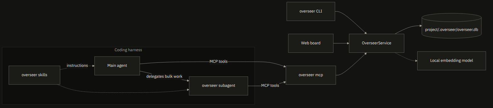

<h1>
  <picture>
    <source media="(prefers-color-scheme: dark)" srcset="https://raw.githubusercontent.com/kodrax/overseer/main/docs/assets/logo-terminal.png">
    <source media="(prefers-color-scheme: light)" srcset="https://raw.githubusercontent.com/kodrax/overseer/main/docs/assets/logo-paper.png">
    
  </picture>
</h1>

A requirements registry and Agile board for coding agents. Local, opt-in and traceable. It never calls an LLM.

overseer stores each project's functional and non-functional requirements, epics, user stories, tasks and bugs in a local SQLite database with multilingual semantic search. It plugs into the coding [harnesses](https://github.com/kodrax/overseer/blob/main/docs/concepts.md#coding-agent-and-harness) you use (Claude Code, OMP, Codex CLI, Gemini CLI, GitHub Copilot CLI, Cursor, OpenCode) as a [subagent](https://github.com/kodrax/overseer/blob/main/docs/concepts.md#subagent), five [skills](https://github.com/kodrax/overseer/blob/main/docs/concepts.md#skill) and an [MCP](https://github.com/kodrax/overseer/blob/main/docs/concepts.md#mcp) server. You can ask your agent "is password reset already covered?" or "record this requirement", or you can use the CLI and the local web board.

- **Off until you turn it on**: overseer works only in the projects where you run `overseer enable`. Everywhere else its tools and commands refuse and create nothing.
- **Local**: data stays in `<project>/.overseer/`. Embeddings run on your machine with `Xenova/multilingual-e5-small` (about 118 MB, downloaded once by `overseer install` or `overseer models pull`). overseer never calls an LLM; your harness's model does the reasoning.
- **Leaves your repository alone**: adding overseer to a project creates only `.overseer/`, and git ignores that folder because it holds its own `.gitignore`. Status and history reach the repository only when you export them.
- **Traceable**: stories and tasks `implement` requirements, and bugs `affect` them. [Coverage](https://github.com/kodrax/overseer/blob/main/docs/concepts.md#coverage) (untracked → tracked → in progress → delivered → verified) is worked out from the linked work, so nobody has to keep it up to date by hand.
- **Catches duplicates**: every new item is compared with the existing items of the same kind, across languages too (an English request matches a Spanish requirement).

<picture>
  <source media="(prefers-color-scheme: dark)" srcset="https://raw.githubusercontent.com/kodrax/overseer/main/docs/assets/architecture-terminal.png">
  <source media="(prefers-color-scheme: light)" srcset="https://raw.githubusercontent.com/kodrax/overseer/main/docs/assets/architecture-paper.png">
  
</picture>

## Install

You need Node.js 22.18 or later and a coding agent: Claude Code, OMP, Codex CLI, Gemini CLI, GitHub Copilot CLI, Cursor or OpenCode.

```sh
npm install -g @kodrax/overseer
overseer install    # choose your harnesses, wire them up, download the model
overseer doctor     # check runtime, model, project and harness setup
```

`overseer install` asks which harnesses to set up, starting from those it finds on your machine, and downloads the embedding model (about 118 MB) once. [Getting started](https://github.com/kodrax/overseer/blob/main/docs/getting-started.md) covers the options, and [Configuration](https://github.com/kodrax/overseer/blob/main/docs/configuration.md#where-the-files-go) every file it writes.

## First run

overseer is off everywhere until you turn it on in a project:

```console
$ cd ~/work/my-app
$ overseer enable
overseer is now on for /home/me/work/my-app and every folder below it.
Its data goes to /home/me/work/my-app/.overseer, created on the first write and ignored by git.
Saved in /home/me/.config/overseer/config.json; "overseer disable" turns it off again.
```

Then talk to your agent as usual: "Record this requirement: when a user requests a password reset, the system shall email a single-use link that expires after 30 minutes." Later, "Is password reset already covered?" The CLI does the same:

```console
$ overseer add requirement --title "Password reset by email" --type functional --status approved \
  --description "When a user requests a password reset, the system shall email a single-use link that expires after 30 minutes." \
  --ac "Given a registered email, when a reset is requested, then a link valid for 30 minutes is sent"
Created REQ-0001  Password reset by email
$ overseer add story --title "Reset forgotten password" \
  --description "As a user I want to reset my password so that I can regain access" --implements REQ-0001
Created US-0001  Reset forgotten password
$ overseer coverage "password reset"
verdict: covered
ID        Status    Coverage  Similarity  Implemented by     Title
--------  --------  --------  ----------  -----------------  -----------------------
REQ-0001  approved  tracked   0.72        US-0001 (backlog)  Password reset by email
$ overseer board
overseer board: http://127.0.0.1:4477/ (Ctrl+C to stop)
```

The story `implements` the requirement, so the requirement's coverage follows the story from `tracked` to `delivered`. The rest of the walk-through, with duplicate checks across languages, is in [Getting started](https://github.com/kodrax/overseer/blob/main/docs/getting-started.md#first-run).

## Documentation

New to coding agents? Start with [Getting started](https://github.com/kodrax/overseer/blob/main/docs/getting-started.md), then [Concepts](https://github.com/kodrax/overseer/blob/main/docs/concepts.md) and the [web board](https://github.com/kodrax/overseer/blob/main/docs/board.md).

| Reference | |
|---|---|
| [CLI reference](https://github.com/kodrax/overseer/blob/main/docs/cli.md) | every command, JSON output, pull requests, worktrees |
| [MCP tools](https://github.com/kodrax/overseer/blob/main/docs/mcp-tools.md) | the tools your agent calls |
| [GitHub and GitLab sync](https://github.com/kodrax/overseer/blob/main/docs/sync.md) | importing issues and keeping repositories in sync |
| [Configuration](https://github.com/kodrax/overseer/blob/main/docs/configuration.md) | settings, environment variables, files, uninstall |
| [Troubleshooting](https://github.com/kodrax/overseer/blob/main/docs/troubleshooting.md) | common errors, status and limitations |

The [docs index](https://github.com/kodrax/overseer/blob/main/docs/README.md) lists every page. To work on overseer itself, see [CONTRIBUTING.md](https://github.com/kodrax/overseer/blob/main/CONTRIBUTING.md); changes are in the [changelog](https://github.com/kodrax/overseer/blob/main/CHANGELOG.md).
