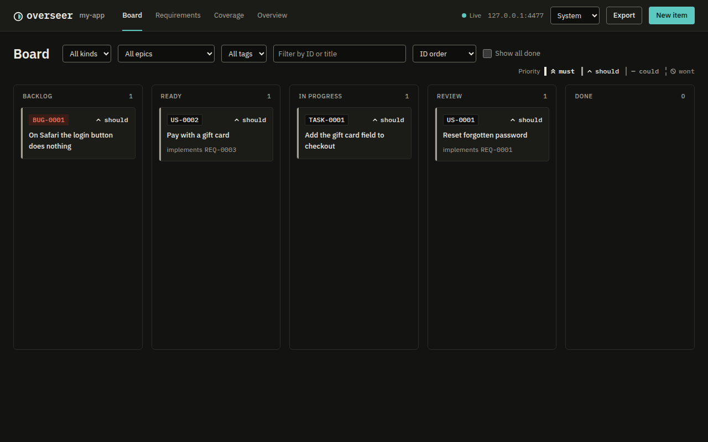

# Web board

The board shows the [registry](concepts.md#registry) in your browser. Start it from the project, or ask your agent to open it:

```sh
overseer board                  # serve and open http://127.0.0.1:4477
overseer board --port 4500 --no-open
```

| Page | What it shows |
|---|---|
| Board | kanban for stories, tasks and bugs, with drag and drop between columns |
| Requirements | table with filters and semantic search |
| Item pages | editable fields, links, children, [coverage](concepts.md#coverage) and history, plus a comment box |
| Coverage | counts, drift and the traceability matrix |
| Overview | every item that is not closed in plain words, grouped as planned, in progress or done, for reviewing the project with a client |
| New item | a dialog with duplicate hints |
| Export | a button that writes the [export](cli.md#commands) into the project |

`overseer board` (or asking the agent to open it, through the `open_board` tool) serves the board on `http://127.0.0.1:4477`. If that port is taken, it tries the next ones, up to 4496.

The page updates live when an agent or the CLI writes to the database, deletions included: a deleted item's card disappears. The server listens on 127.0.0.1 only and rejects requests whose `Host` is not localhost. Writes need a token generated each time the server starts.



[Configuration](configuration.md#project-settings) sets the default port (`board_port`).

---

You have reached the end of the Start here path. From here, the [Reference](README.md#reference) section of the docs index goes into each part in detail.
