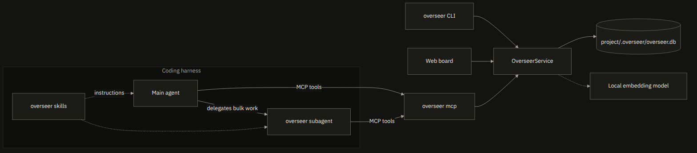

# Concepts

The terms overseer uses, how its parts fit together, and its data model. Each term below is short; the sections after it go into detail.

## Terms

### Coding agent and harness

A coding agent is an AI model that reads and changes your code from a chat. The harness is the program it runs in: Claude Code, OMP, Codex CLI, Gemini CLI, GitHub Copilot CLI, Cursor or OpenCode. overseer never calls a model itself; your harness's model does the reasoning and calls overseer's tools.

### MCP

The Model Context Protocol is how a harness gives its agent extra tools. `overseer mcp` is an MCP server: the harness starts it, and the agent calls its tools, such as `create_item` and `check_coverage`. The [MCP tools](mcp-tools.md) page lists them. The harness can also reach GitHub or GitLab through their MCP servers, which is how overseer's skills import and sync issues without overseer storing any token.

### Skill

A skill is a folder of instructions (`SKILL.md`) that the harness hands its agent when a task matches. `overseer install` adds five:

| Skill | Teaches the agent to |
|---|---|
| `overseer` | record requirements, stories, tasks and bugs, check coverage, update statuses, produce reports |
| `overseer-bootstrap` | discover requirements in an existing codebase, or ask a short interview for a new project |
| `overseer-import` | import GitHub or GitLab issues into the board |
| `overseer-ship` | take one item from a branch to a pull request |
| `overseer-sync` | connect the board to GitHub or GitLab repositories and keep them in sync |

### Subagent

A subagent is a second agent that the main agent hands a job to, with its own instructions and its own context. The `overseer` subagent takes bulk work, such as bootstrapping requirements or importing issues. Quick lookups and edits stay with the main agent, which calls the MCP tools directly.

### Registry

The registry is a project's database of items: `.overseer/overseer.db` at the root of the repository, ignored by git. Every harness and the CLI use the same one. [Configuration](configuration.md#project-data) lists the files.

### Items

overseer keeps five kinds of items. A requirement says what the product shall do. An epic groups stories, a story is something a user wants, a task is one pull request of work, and a bug is something broken. [Data model](#data-model) has their IDs, statuses and relations.

### EARS

EARS (Easy Approach to Requirements Syntax) writes each requirement as one sentence in a fixed pattern, such as "When <trigger>, the <system> shall <response>". overseer's skills ask agents to write requirements this way, and lint flags a requirement with several "shall" clauses.

### Acceptance criteria and priority

Acceptance criteria say how to check that an item is done, as "Given <context>, when <action>, then <result>". Priority follows MoSCoW: `must`, `should`, `could` or `wont`.

### Functional and non-functional requirements

A functional requirement is something the product does. A non-functional requirement is a quality, such as speed or security: it carries an ISO/IEC 25010 category and a fit criterion, a number you can measure ("under 300 ms at p95").

### Coverage

Coverage says how far the work on a requirement has got: `untracked`, `tracked`, `in_progress`, `delivered`, `verified`, or `not_applicable`. overseer works it out from the stories, tasks and bugs linked to the requirement, so nobody updates it by hand. The [coverage table](#data-model) says when each value applies.

### Drift

Drift is a requirement whose status disagrees with its work: the work is done but the requirement is still open, the requirement is marked implemented while its work is unfinished, or work has started on a requirement nobody approved. `overseer report drift` lists it.

### Lint

Lint checks the wording of items: vague terms, missing acceptance criteria, stories not written as "As a… I want… so that…". Its warnings come back when you create or update an item and never block the write.

### Duplicate check

Before an item is written, overseer compares it with the existing items of the same kind, across languages, and refuses a likely duplicate. [Semantic search and duplicates](#semantic-search-and-duplicates) explains how.

### Source of truth and outbox

When the board syncs with GitHub or GitLab, the source of truth decides which side wins a conflicting edit, and the outbox holds local changes waiting to be pushed. [GitHub and GitLab sync](sync.md#source-of-truth) covers both.

### Worktree

A git worktree is a second checkout of the same repository in another folder, on its own branch. `overseer worktree start` gives each task or bug its own, so several can be worked on at once. See [Worktrees](cli.md#worktrees).

## How the pieces fit

In your harness, the overseer skills instruct the main agent and the overseer subagent. Both call the `overseer mcp` server through MCP tools. The CLI, the web board and the MCP server all use the same service, which stores data in `.overseer/overseer.db` and uses the local embedding model.

<picture>
  <source media="(prefers-color-scheme: dark)" srcset="https://raw.githubusercontent.com/kodrax/overseer/main/docs/assets/architecture-terminal.png">
  <source media="(prefers-color-scheme: light)" srcset="https://raw.githubusercontent.com/kodrax/overseer/main/docs/assets/architecture-paper.png">
  
</picture>

## Data model

| Kind | IDs | Statuses (the first is the default) |
|---|---|---|
| requirement | `REQ-0001` | `proposed`, `approved`, `implemented`, `verified`, `deferred`, `rejected`, `obsolete` |
| epic | `EPIC-0001` | `open`, `in_progress`, `done`, `cancelled` |
| story | `US-0001` | `backlog`, `ready`, `in_progress`, `review`, `done`, `cancelled` |
| task | `TASK-0001` | same as story |
| bug | `BUG-0001` | same as story |

Close items with a status. Lists hide `rejected`, `obsolete` and `cancelled` items unless you ask for `--all`.

`overseer delete <id>` (`delete_item` in MCP) removes an item for good, in one transaction: its row, its links in both directions (each recorded as an `unlink` event on the linking item), its embeddings and its keyword-index row. An item with children is refused with `CONFLICT` listing them, and nothing is deleted. A tombstone keeps the ID, kind, title, external refs (the `external_ref` of an imported item and its refs in connected repositories), `deleted_at` and the actor; a `delete` event joins the history. `show` and `get_item` on the ID answer `NOT_FOUND: Item TASK-0007 was deleted on <time>.`; `overseer export` keeps its events in `history.md` and `overseer.json`. IDs come from per-kind counters, so a deleted ID is never reused. `--json` prints `{"deleted": true, "id", "kind", "title", "external_refs": [{"connection_id", "external_ref", "url"}], "deleted_at", "actor"}`.

Requirements carry:
- an EARS statement ("When <trigger>, the <system> shall <response>")
- a type: functional or non-functional
- for non-functional requirements, an ISO/IEC 25010 category and a measurable fit criterion
- a MoSCoW priority, a rationale and Given/When/Then acceptance criteria
- a verification method
- who asked for it, where it came from and which tool recorded it
- whether it is in the backlog
- tags, component, code references and delivery details

The fields an agent sets are in [`templates/skills/overseer/references/fields.md`](../templates/skills/overseer/references/fields.md); read-only fields, statuses, coverage, drift and lint rules are in [`references/board.md`](../templates/skills/overseer/references/board.md).

| Relation | From → to |
|---|---|
| `implements` | story/task → requirement (also marks the requirement as in the backlog) |
| `affects` | bug → requirement/story |
| `refines`, `conflicts_with`, `supersedes` | requirement → requirement |
| `duplicates` | between items of the same kind |
| `depends_on`, `relates_to` | any → any |

Allowed parents: a story belongs to an epic, a task to a story, a bug to an epic or a story, and a requirement to another requirement (to break it down).

Requirement coverage is worked out from the linked work:

| Coverage | When |
|---|---|
| `untracked` | no implementing items and not in the backlog |
| `tracked` | in the backlog, or has implementing items |
| `in_progress` | an implementing item is `in_progress` or `review` |
| `delivered` | the requirement is `implemented`, or all its implementing items are `done` |
| `verified` | the requirement is `verified` |
| `not_applicable` | the requirement is `deferred`, `rejected` or `obsolete` |

Cancelled implementing items are ignored: they neither count as work nor keep a requirement from being delivered.

- **`report drift`** flags status mismatches. It catches three cases: the work is done but the requirement is still open; the requirement is marked implemented while its work is unfinished; work has started on an unapproved requirement.
- **Lint warnings** (`report lint`, and the warnings returned when you create or update an item) cover:
  - vague terms in English and Spanish
  - several "shall" clauses in one requirement
  - non-functional requirements that can't be measured or lack a category
  - missing acceptance criteria
  - stories not written as "As a… I want… so that…"
  - titles over 100 characters (`title_too_long`)

  Warnings never block a write.

## Semantic search and duplicates

- Search combines FTS5 keyword matches with vector nearest neighbours and merges both rankings (reciprocal rank fusion).
- Each item gets three vectors: its full text (with acceptance criteria), its title, and its title plus description. An item's score is the highest of the three.
- Similarity and coverage checks subtract the mean vector of the project's items from both vectors before taking the cosine. Items of one product share a vocabulary: with plain cosine, every requirement of this repository scored between 0.85 and 0.96 against its nearest neighbour, so no threshold could tell duplicates apart. While a project has few items, the mean leans on a reference mean shipped for the model.
- A similarity of 0.61 or more counts as a duplicate, and 0.22 or more as related. `npm run calibrate` set these thresholds on two sets:
  - this repository's 242 requirements with 31 hand-written rewordings (`test/fixtures/registry-pairs.json`)
  - 71 English/Spanish requirement pairs (`test/fixtures/similarity-pairs.json`)

  At these thresholds, 5% of the requirements have a duplicate-class neighbour. 84% of the rewordings and 70% of the fixture duplicates count as duplicates, and every one of them at least as related.
- `add` and `create_item` compare the new item only with existing items of the same kind, and return the candidates instead of creating the item when a duplicate is likely. When they do create it, they still return the `verdict` and the duplicate or related candidates. A batch also compares each entry with the earlier entries of the same kind, using the same vectors and thresholds, and embeds all of its texts before the write.
- `search` reports plain cosine similarity, which only orders the results.
- Without the model or `sqlite-vec`, results are keyword-only and carry `semantic: false` with a `warning`. Searches, similarity and coverage checks never download the model: until `overseer models pull` (or `overseer install`) puts it in the model cache, they answer from the keyword index and the warning names `overseer models pull`. `overseer doctor --deep` then reports the model load check as skipped instead of loading it.

---

Next: [Web board](board.md), the same registry in your browser.
